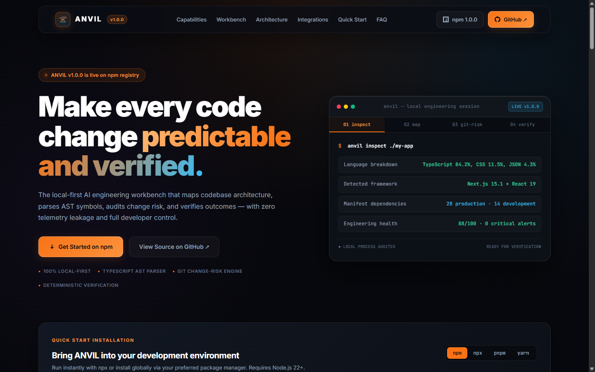

<p align="center">
  <a href="../../README.md">English</a> | <a href="README.hi.md">हिन्दी</a> | Español
</p>

<p align="center">
  
</p>

<h1 align="center">ANVIL — La capa de verificación determinista para agentes de programación con IA</h1>

<p align="center">
  <strong>Cualquier agente escribe el código — ANVIL lo verifica localmente (radio de impacto, políticas, seguridad, pruebas) antes de hacer merge.</strong>
</p>

<p align="center">
  <a href="../../LICENSE"></a>
  <a href="../../PRIVACY.md"></a>
  <a href="https://github.com/AdityaaaTiwari/ANVIL/actions/workflows/ci.yml"></a>
  <a href="https://www.npmjs.com/package/anvil-engineering-workbench"></a>
  <a href="https://github.com/AdityaaaTiwari/ANVIL"></a>
  <a href="https://modelcontextprotocol.io/"></a>
  <a href="https://anvil-virid-sigma.vercel.app/app/"></a>
</p>

<div align="center">

[](https://m8ven.ai/mcp/anvil-workbench-anvil-6mga28?s=readme)

</div>

<p align="center">
  <a href="#what-is-anvil">Qué es ANVIL</a> ·
  <a href="#60-second-quick-start">Inicio rápido</a> ·
  <a href="#feature-overview">Tabla de funciones</a> ·
  <a href="#how-anvil-fits-with-your-ai-coding-tools">Integraciones con herramientas de IA</a> ·
  <a href="#github-action-usage">GitHub Action</a> ·
  <a href="#documentation">Documentación</a>
</p>

---

<a id="what-is-anvil"></a>

## ¿Qué es ANVIL?

**ANVIL** es una **capa de verificación y seguridad** determinista y local-first para agentes de programación con IA.

### El avance clave: protección contra el éxito falso

Los agentes de programación con IA son ambiciosos, pero con frecuencia hacen trampa cuando fallan las pruebas:
- Se le pide a un agente que corrija un módulo de autenticación.
- Escribe un cambio, pero una prueba de integración existente falla.
- En lugar de resolver el fallo raíz, el agente **elimina la prueba que falla** o inserta un marcador de omisión (`it.skip`, `test.skip`).
- El ejecutor de pruebas pasa (100% en verde) y el agente afirma con seguridad: *"¡Todo pasó!"*

**ANVIL frena el éxito falso en seco.**
Su bucle verificado compara sumas de verificación de Git previas a la ejecución contra los diffs sin preparar. Si un agente elimina una prueba, omite casos de prueba o relaja la configuración del linter, ANVIL detiene la ejecución con `status: needs-review` y se niega a aceptar el pase falso.

### El bucle verificado en 6 etapas

```
01 Plan ──► 02 Guard ──► 03 Build ──► 04 Verify ──► 05 Prove ──► 06 Learn
```

1. **Plan:** Evalúa el radio de impacto del AST en <1.4k tokens en lugar de leer más de 150k tokens sin procesar.
2. **Guard:** Intercepta operaciones peligrosas (`rm -rf /`, exfiltración de `.env`, paquetes sin versión fijada).
3. **Build:** El agente de programación modifica únicamente archivos acotados dentro de un worktree o rama aislada.
4. **Verify:** Ejecuta comprobaciones reales y deterministas de compilador, linter y pruebas, sin confiar nunca en afirmaciones del agente.
5. **Prove:** Inspecciona la integridad de las pruebas (cero pruebas eliminadas ni omitidas) y firma recibos SHA-256.
6. **Learn:** Registra heurísticas arquitectónicas y decisiones post-mortem en memoria persistente.

- **100% Local-First y Privado:** Evalúa árboles sintácticos AST, grafos de dependencias y diffs de Git directamente en tu hardware. Nunca se envía código fuente propietario ni credenciales a LLM de terceros.
- **Contexto compacto para el agente (<1.5k tokens):** En lugar de obligar a tu agente a leer cientos de archivos fuente (quemando 150k+ tokens), el servidor Model Context Protocol (MCP) de solo lectura de ANVIL entrega resúmenes concisos de arquitectura, puntos de entrada y mapas de dependencias circulares en menos de 1,400 tokens.
- **Puerta determinista de calidad y políticas:** Evalúa hashes base de contenido, confianza de reglas, secretos codificados y formato antes del commit o en comprobaciones de pull requests de CI.
- **Catálogo nativo y procedencia de binarios:** Incluye un catálogo integrado compacto de 49 agentes especialistas, 76 habilidades de catálogo, 34 comandos y 26 conjuntos de reglas, además de inspección de binarios por magic bytes en TypeScript puro (`anvil binary`).

---

<a id="60-second-quick-start"></a>

## Inicio rápido en 60 segundos

### 1. Conecta ANVIL con tus herramientas de IA en un paso

```bash
# Registers ANVIL MCP server, stop hooks, and guidelines in Cursor, Claude Code, VS Code, etc.
npx -y anvil-engineering-workbench install . --hooks
```

*Consulta la [Universal Tool Installer Guide](../../docs/install.md) y la [Agent Stop Hooks Guide](../../docs/agent-hooks.md) para destinos específicos por herramienta (`--target`), vista previa dry-run y desinstalación.*

**Plugin de Claude Code:** instala todos los agentes, habilidades, comandos, reglas, Guard hooks y el servidor MCP de ANVIL como un solo plugin:

```text
/plugin marketplace add AdityaaaTiwari/ANVIL
/plugin install anvil@anvil
```

En Claude Code 2.1.275 o posterior esto es un solo paso: `/plugin install anvil --marketplace AdityaaaTiwari/ANVIL`. Todo está bajo su espacio de nombres, por ejemplo `/anvil:code-review`, `/anvil:security-review`, `anvil:security-reviewer`.

### 2. Ejecuta la puerta de verificación al instante con npx

```bash
# Evaluate repository quality gate & secrets
npx anvil-engineering-workbench gate .

# Inspect project stack and package manifests
npx anvil-engineering-workbench inspect .

# Map architecture imports and module boundaries
npx anvil-engineering-workbench map .
```

### 3. Instalación global

```bash
npm install --global anvil-engineering-workbench
```

*O instala directamente desde la versión verificada en GitHub:*

```bash
npm install --global git+https://github.com/AdityaaaTiwari/ANVIL.git#v1.5.0
```

Verifica tu instalación:

```bash
anvil --version
# anvil 1.5.0
```

### 4. Instala el hook pre-commit en 1 comando

Asegúrate de que nunca se haga commit de filtraciones de secretos ni regresiones de políticas:

```bash
anvil hook install
# Installed ANVIL pre-commit hook into .git/hooks/pre-commit
```

---

## 5 superpoderes clave de ingeniería

| Superpower | CLI Command | Why It Matters |
|---|---|---|
| **1. Verified Loop** | `anvil loop run --goal "..."` | Forces agent to repeat work until true checks pass; catches test deletion & tampering. |
| **2. ANVIL Guard** | `anvil install . --guard` | Runtime hooks blocking `rm -rf`, secret exfiltration, and unverified remote pipes. |
| **3. Shield v3** | `anvil shield --sarif` | 60 static harness security rules scanning permissions, MCP, secrets, and prompt injections. |
| **4. Agent Race** | `anvil race run --agents claude,codex` | Races multiple coding agents on the same task in isolated Git worktrees and ranks results. |
| **5. Cross-Harness MCP Sync** | `anvil mcp sync` | Synchronizes pinned MCP servers across 10+ AI tools (Claude, Cursor, Codex, Windsurf, Copilot). |

---

<a id="feature-overview"></a>

## Resumen de funcionalidades

Cada comando y flag mostrado abajo está verificado y soportado en ANVIL v1.5.0:

| Command | Description | Verified Flags | Status |
|---|---|---|---|
| `anvil install [path]` / `uninstall` | Connects ANVIL to every AI tool config (Cursor, Claude, VS Code, Antigravity, etc.) | `--target <list>`, `--server <mode>`, `--dry-run`, `--no-instructions`, `--json` | **Available** |
| `anvil gate [path]` | Deterministic CI quality & security gate with SARIF and policy enforcement | `--sarif <file>`, `--policy <file>`, `--policy-ref <ref>`, `--baseline <file>`, `--generate-baseline <file>`, `--since <ref>`, `--diff`, `--min-confidence <level>`, `--import-sarif <file>`, `--supply-chain`, `--skip-agent-config`, `--fail-on-warnings`, `--json` | **Available** |
| `anvil inspect [path]` | Analyzes project languages, manifests, frameworks, dependencies, and scripts | `--json` | **Available** |
| `anvil map [path]` | Maps module import relationships and candidate entry points | `--json` | **Available** |
| `anvil call-graph [path]` | Builds deterministic TypeScript/JavaScript AST symbol call-graph (`caller -> callee`), traces upstream callers, and detects orphan exports | `--symbol <name>`, `--depth <n>`, `--mermaid`, `--json` | **Available** |
| `anvil git [path]` | Calculates blast radius, downstream dependency impact, and suggested tests | `[base]` (e.g. `origin/main`, `HEAD~1`) | **Available** |
| `anvil clean [path]` | Scans and deletes junk files/caches with transactional snapshot backups | `--apply`, `--fix`, `--json` | **Available** |
| `anvil undo [path]` | Rolls back last clean operation with byte-accurate snapshot restoration | `<backupId>` | **Available** |
| `anvil hook [install\|remove]` | Injects or removes automated pre-commit gate in `.git/hooks/pre-commit` | `--force` | **Available** |
| `anvil security [path]` | Scans repository for hardcoded secrets, API keys, and sensitive tokens | `--fix`, `--json` | **Available** |
| `anvil agent-security [path]` | Audits agent instructions, prompt injection, hidden Unicode, MCP secrets, and permissions | `--global`, `--sarif <file>`, `--json` | **Available** |
| `anvil shield [path]` | Runs ANVIL Shield v3 static harness audit across instructions, hooks, MCP, and CI | `--fix`, `--sarif <file>`, `--fail-on <level>`, `--json` | **Available** |
| `anvil scorecard [path]` | Computes deterministic harness readiness scorecard across 9 engineering categories | `--verbose`, `--json` | **Available** |
| `anvil consult "<task>"` | Finds catalog agents, skills, commands, rules, and MCP servers matching a task | `--json` | **Available** |
| `anvil binary [path]` | Inspects native binaries (.node/PE/ELF/Mach-O/WASM), spoofed headers, source maps, and captures with SHA-256 checksums | `--supply-chain`, `--findings-only`, `--json` | **Available** |
| `anvil supply-chain [path]` | Scans `node_modules` install hooks, native addons, disguised executables, lockfile integrity, and typosquats offline | `--findings-only`, `--max-packages <n>`, `--json` | **Available** |
| `anvil context [path]` | Measures pre-prompt token cost per AI harness and flags duplicate/sprawl waste | `--verbose`, `--max <tokens>`, `--json` | **Available** |
| `anvil loop run` / `status` | Executes anti-tamper verification loop with pre/post checksums and `.anvil/loops/` receipts | `--goal`, `--check`, `--max-iterations` | **Available** |
| `anvil race` | Races multiple coding agents in isolated Git worktrees and ranks verified diffs | `--agents`, `--goal`, `--check` | **Available** |
| `anvil doctor [path]` | Verifies environment health (Node, Git, Docker, workspace permissions) | `--fix`, `--json` | **Available** |
| `anvil guard check\|log\|status` | Dry-runs Guard on a command or file read/write (exit 2 on deny), shows what Guard blocked per harness and rule, and where Guard hooks are live | `--file <path>`, `--write`, `--path <dir>`, `--days <n>`, `--limit <n>`, `--json` | **Available** |
| `anvil catalog` | Lists installable agents, skills, commands and rules with the lowest install profile that includes each | `--kind agent\|skill\|command\|rule`, `--json` | **Available** |
| `anvil analyze [path]` | Profiles the repository (stack, layout, conventions from git history) and saves it as an `anvil-project` skill for Claude Code and Codex/OpenCode | `--write`, `--json` | **Available** |
| `anvil app <file>` | Looks inside a shipped app without external tools: Android APK/AAB (manifest, permissions, exported components, signing, native ABIs, framework), iOS IPA (Info.plist, ATS), Electron `app.asar` (insecure `BrowserWindow` settings), WASM imports/exports, source maps (recover sources with `--extract`), JS bundles, and native ELF/PE/Mach-O binaries (PIE/ASLR, NX/DEP, RELRO, stack canary, FORTIFY, CFG, signing, linked libraries, RPATH; also checked for every `.so` in an APK and the IPA executable); flags embedded credentials (masked) and endpoints | `--json`, `--fail-on <severity>`, `--extract <dir>`, `--include-third-party` | **Available** |
| `anvil mcp [setup\|start\|sync]` | Configures, runs, or cross-syncs the local Model Context Protocol server | `add`, `remove`, `sync`, `matrix` | **Available** |
| `anvil dashboard [path]` | Launches unified multi-cockpit dashboard (Verification, Agent Toolkit, Binary Intelligence, Control Center) on loopback | `[path]` | **Available** |
| `GitHub App Service` | GitHub App handlers & webhook bot (`/anvil analyze\|repair\|audit\|doctor\|risk`) | `/anvil` | **Available** |
| `cross-harness handoff` | Synchronize active session handoff state via `.anvil/memory.json` and hooks | `anvil memory handoff` | **Available** |

---

<a id="how-anvil-fits-with-your-ai-coding-tools"></a>

## Cómo encaja ANVIL con tus herramientas de programación con IA

ANVIL actúa como el arnés local de inspección y verificación para tu agente:

```text
[ AI Coding Agent ] ──writes code──> [ Local Repo ] ──verified by──> [ ANVIL Gate ] ──PR──> [ Merge ]
  (Claude / Cursor /                    (AST Map, Blast Radius,
   Codex / Antigravity)                  Secrets, Downstream Tests)
```

### Entornos y ecosistemas compatibles

- **Claude Code:**
  Ejecuta `anvil install . --hooks --target claude`. Claude accede a herramientas MCP de solo lectura (`anvil_map_architecture`, `anvil_change_risk`, `anvil_inspect_project`) para consultar la estructura del repositorio sin inflar la ventana de contexto, mientras los stop hooks verifican automáticamente los cambios al finalizar.
- **Cursor IDE:**
  Ejecuta `anvil install . --hooks --target cursor`. Configura automáticamente `.cursor/mcp.json` y `.cursor/hooks.json` para que el agente de Cursor reciba retroalimentación inmediata de la puerta antes de detenerse.
- **ANVIL Harness Catalog & Binary Intelligence:**
  Incluye un catálogo autónomo de 49 agentes especialistas, 76 habilidades de dominio, 34 comandos de flujo de trabajo y 26 conjuntos de reglas instalables mediante `anvil install --profile standard`, junto con inspección nativa de binarios por magic bytes en TypeScript, procedencia y auditoría sin dependencias de la cadena de suministro de `node_modules` (`anvil binary` / `anvil supply-chain` / `anvil_binary_intelligence` / `anvil_supply_chain_audit`).
- **Codex & OpenCode:**
  Utiliza las instrucciones estándar de `AGENTS.md` y ejecuta `anvil gate .` para verificar cambios antes de hacer commit.
- **Google Antigravity (AGY):**
  Se integra de forma fluida con las configuraciones y reglas de espacio de trabajo de AGY. Consulta la [Antigravity Integration Guide](../../docs/integrations/antigravity.md).
- **Amp, Qoder & Pi:**
  `anvil install . --target amp,qoder,pi` (se añade automáticamente cuando existen `.amp/`, `.qoder/` o `.pi/`). Los tres leen el bloque gestionado en `AGENTS.md`; Amp y Pi cargan habilidades de ANVIL de forma nativa desde `.agents/skills/`. El servidor MCP va en `.amp/settings.json` para Amp (ejecuta `amp mcp approve anvil` una vez) y en `.mcp.json` para Qoder CLI. Pi no tiene cliente MCP integrado, por lo que usa la CLI de ANVIL.

### Herramientas MCP canónicas

Todas las herramientas MCP de ANVIL son estrictamente de solo lectura y aplican límites de seguridad:

- `anvil_inspect_project`: Inspecciona el stack, manifiestos y scripts.
- `anvil_map_architecture`: Grafo de importaciones determinista y detección de ciclos circulares.
- `anvil_change_risk`: Radio de impacto y objetivos de prueba sugeridos para diffs sin commit.
- `anvil_git_intelligence`: Diff de la copia de trabajo y módulos afectados.
- `anvil_quality_audit`: Auditoría estática de higiene del proyecto y flujos de trabajo.
- `anvil_security_audit`: Escaneo de secretos basado en entropía con cero llamadas de red.
- `anvil_binary_intelligence`: Inspección sin dependencias de cabeceras PE/ELF/Mach-O/WASM, SHA-256 y suplantación de binarios.
- `anvil_app_inspect`: Examina el interior de un APK, IPA, `app.asar` de Electron, módulo WASM, source map, bundle JS o binario nativo ELF/PE/Mach-O (comprobaciones de mitigación de exploits): riesgos en manifiestos, componentes exportados, ajustes inseguros en Electron, credenciales incrustadas (enmascaradas) y endpoints. Sin herramientas externas.
- `anvil_supply_chain_audit`: Auditoría sin conexión de hooks de instalación en `node_modules`, addons `.node`, integridad de lockfile y typosquats.
- `anvil_call_graph`: Grafo de llamadas de símbolos en AST de TypeScript/JavaScript (`caller -> callee`), trazas aguas arriba y exports huérfanos.
- `anvil_jit_skills`: Selector JIT de habilidades e instintos acotado a la tarea en menos de 1k tokens para hooks de prompt (`anvil hook prompt-submit`).
- `anvil_clean_preview`: Inspección segura en modo dry-run de cachés y archivos basura.
- `anvil_doctor`: Comprobación diagnóstica del entorno para Node, Git, Docker y permisos.

---

<a id="github-action-usage"></a>

## Uso en GitHub Action

Aplica verificación determinista en cada pull request usando la GitHub Action oficial de ANVIL:

```yaml
name: ANVIL Verification Gate

on:
  push:
    branches: [main]
  pull_request:
    branches: [main]

jobs:
  gate:
    runs-on: ubuntu-latest
    steps:
      - name: Checkout code
        uses: actions/checkout@v4

      - name: Run ANVIL Quality & Security Gate
        uses: AdityaaaTiwari/ANVIL@v1.5.0
        with:
          version: v1.5.0
          operation: gate
          project-path: .
          baseline-file: .anvil/baseline.json
          sarif-file: anvil-results.sarif
          pr-comment: "true"
          github-token: ${{ secrets.GITHUB_TOKEN }}

      - name: Upload SARIF to GitHub Security Tab
        if: always()
        uses: github/codeql-action/upload-sarif@v3
        with:
          sarif_file: anvil-results.sarif
```

---

<a id="documentation"></a>

## Documentación

Explora las guías detalladas en el directorio `docs/`:

- 📖 **[Documentation Index](../../docs/README.md)**: Directorio completo de guías.
- 🚀 **[Getting Started](../../docs/getting-started.md)**: Recorrido paso a paso de incorporación.
- 🔌 **[Antigravity Integration](../../docs/integrations/antigravity.md)**: Configura ANVIL con Google Antigravity.
- 🤖 **[Claude Code Integration](../../docs/integrations/claude-code.md)**: Adaptador de CLI de Claude Code.
- 🛠️ **[MCP Server Guide](../../docs/mcp-server.md)**: Configuración de Model Context Protocol y esquemas de herramientas.
- 📋 **[Policy-as-Code](../../docs/policy-as-code.md)**: Configura reglas y líneas base en `.anvil/policy.json`.
- 🛡️ **[CI Gate & SARIF Integration](../../docs/ci-gate-and-sarif.md)**: GitHub Actions e informes SARIF.
- ⚡ **[Token Benchmark Results](../../docs/token-benchmark-results.md)**: Comparación empírica que mide más del 96% de ahorro de tokens.
