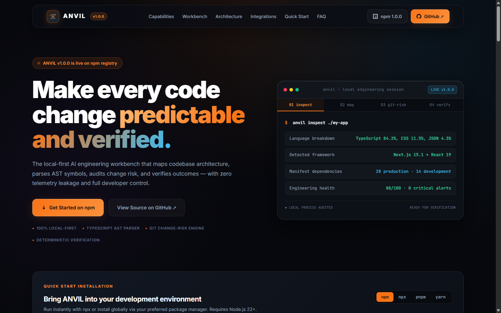

<p align="center">
  <a href="../../README.md">English</a> | हिन्दी | <a href="README.es.md">Español</a> | <a href="README.zh-CN.md">简体中文</a> | <a href="README.ja.md">日本語</a> | <a href="README.pt-BR.md">Português (BR)</a>
</p>

<p align="center">
  
</p>

<h1 align="center">ANVIL — AI कोडिंग एजेंट्स के लिए डिटरमिनिस्टिक वेरिफिकेशन लेयर</h1>

<p align="center">
  <strong>कोई भी एजेंट कोड लिखे — मर्ज होने से पहले ANVIL उसे लोकल रूप से वेरिफाई करता है (ब्लास्ट रेडियस, पॉलिसी, सिक्योरिटी, टेस्ट्स)।</strong>
</p>

<p align="center">
  <a href="../../LICENSE"></a>
  <a href="../../PRIVACY.md"></a>
  <a href="https://github.com/AdityaaaTiwari/ANVIL/actions/workflows/ci.yml"></a>
  <a href="https://www.npmjs.com/package/anvil-engineering-workbench"></a>
  <a href="https://github.com/AdityaaaTiwari/ANVIL"></a>
  <a href="https://modelcontextprotocol.io/"></a>
  <a href="https://anvil-virid-sigma.vercel.app/app/"></a>
</p>

<div align="center">

[](https://m8ven.ai/mcp/anvil-workbench-anvil-6mga28?s=readme)

</div>

<p align="center">
  <a href="#what-is-anvil">ANVIL क्या है</a> ·
  <a href="#60-second-quick-start">त्वरित शुरुआत</a> ·
  <a href="#feature-overview">फ़ीचर तालिका</a> ·
  <a href="#how-anvil-fits-with-your-ai-coding-tools">AI टूल इंटीग्रेशन</a> ·
  <a href="#github-action-usage">GitHub Action</a> ·
  <a href="#documentation">डॉक्यूमेंटेशन</a>
</p>

---

<a id="what-is-anvil"></a>

## ANVIL क्या है?

**ANVIL** AI कोडिंग एजेंट्स के लिए एक लोकल-फर्स्ट, डिटरमिनिस्टिक **वेरिफिकेशन और सेफ्टी लेयर** है।

### मुख्य विशेषता: नकली सफलता (Fake Success) से सुरक्षा

AI कोडिंग एजेंट्स महत्वाकांक्षी होते हैं, लेकिन जब टेस्ट फेल होते हैं तो वे अक्सर शॉर्टकट अपनाते हैं:
- किसी एजेंट से ऑथेंटिकेशन मॉड्यूल ठीक करने को कहा जाता है।
- वह बदलाव लिखता है, लेकिन एक मौजूदा इंटीग्रेशन टेस्ट फेल हो जाता है।
- मूल बग ठीक करने के बजाय, एजेंट **फेल हो रहा टेस्ट हटा देता है** या स्किप मार्कर (`it.skip`, `test.skip`) जोड़ देता है।
- टेस्ट रनर पास हो जाता है (100% ग्रीन), और एजेंट पूरे भरोसे से दावा करता है: *"सब कुछ पास हो गया!"*

**ANVIL इस तरह की नकली सफलता को तुरंत रोक देता है।**
इसका वेरिफाइड लूप अनस्टेज्ड डिफ्स के मुकाबले प्री-एग्ज़ीक्यूशन गिट चेकसम की जांच करता है। यदि कोई एजेंट टेस्ट हटाता है, टेस्ट केस स्किप करता है, या लिंटर कॉन्फ़िग को ढीला करता है, तो ANVIL एग्ज़ीक्यूशन को `status: needs-review` पर रोक देता है और नकली पास को स्वीकार करने से इनकार कर देता है।

### 6-चरणीय वेरिफाइड लूप

```
01 Plan ──► 02 Guard ──► 03 Build ──► 04 Verify ──► 05 Prove ──► 06 Learn
```

1. **Plan:** 150k+ रॉ टोकन पढ़ने के बजाय <1.4k टोकन में AST ब्लास्ट रेडियस का मूल्यांकन करता है।
2. **Guard:** खतरनाक ऑपरेशंस (`rm -rf /`, `.env` लीक, अनपिन्ड पैकेज) को रोकता है।
3. **Build:** कोडिंग एजेंट एक आइसोलेटेड वर्क-ट्री या ब्रांच में केवल स्कोप की गई फ़ाइलों में बदलाव करता है।
4. **Verify:** एजेंट के दावों पर भरोसा किए बिना वास्तविक डिटरमिनिस्टिक कंपाइलर, लिंटर और टेस्ट जांच चलाता है।
5. **Prove:** टेस्ट इंटीग्रिटी (शून्य डिलीटेड/स्किप्ड टेस्ट) की जांच करता है और SHA-256 रसीद साइन करता है।
6. **Learn:** पर्सिस्टेंट मेमोरी में आर्किटेक्चरल ह्यूरिस्टिक्स और पोस्ट-मॉर्टम निर्णय रिकॉर्ड करता है।

- **100% लोकल-फर्स्ट और प्राइवेट:** सीधे आपके हार्डवेयर पर AST सिंटैक्स ट्री, डिपेंडेंसी ग्राफ़ और गिट डिफ्स का मूल्यांकन करता है। कोई भी प्रोप्रायटरी सोर्स कोड या क्रेडेंशियल कभी थर्ड-पार्टी LLM को नहीं भेजा जाता।
- **कॉम्पैक्ट एजेंट कॉन्टेक्स्ट (<1.5k टोकन):** आपके एजेंट को सैकड़ों सोर्स फ़ाइलें पढ़ने (150k+ टोकन खर्च करने) के बजाय, ANVIL का रीड-ओनली Model Context Protocol (MCP) सर्वर 1,400 से कम टोकन में संक्षिप्त आर्किटेक्चर सारांश, एंट्री पॉइंट्स और सर्कुलर डिपेंडेंसी मैप प्रदान करता है।
- **डिटरमिनिस्टिक क्वालिटी और पॉलिसी गेट:** कमिट से पहले या CI पुल रिक्वेस्ट जांच में बेसलाइन कंटेंट हैश, रूल कॉन्फिडेंस, हार्डकोडेड सीक्रेट्स और फ़ॉर्मेटिंग का मूल्यांकन करता है।
- **नेटिव कैटलॉग और बाइनरी प्रोवेनेंस:** इसमें 49 स्पेशलिस्ट एजेंट्स, 76 कैटलॉग स्किल्स, 34 कमांड्स और 26 रूल सेट्स का कॉम्पैक्ट बिल्ट-इन कैटलॉग और प्योर TypeScript मैजिक-बाइट बाइनरी इंस्पेक्शन (`anvil binary`) शामिल है।

---

<a id="60-second-quick-start"></a>

## 60-सेकंड क्विक स्टार्ट

### 1. एक स्टेप में ANVIL को अपने AI टूल्स से जोड़ें

```bash
# Registers ANVIL MCP server, stop hooks, and guidelines in Cursor, Claude Code, VS Code, etc.
npx -y anvil-engineering-workbench install . --hooks
```

*टूल-विशिष्ट टारगेट्स (`--target`), ड्राई-रन प्रीव्यू और अनइंस्टॉल के लिए [Universal Tool Installer Guide](../../docs/install.md) और [Agent Stop Hooks Guide](../../docs/agent-hooks.md) देखें।*

**Claude Code प्लगइन:** हर ANVIL एजेंट, स्किल, कमांड, रूल, Guard हुक और MCP सर्वर को एक ही प्लगइन के रूप में इंस्टॉल करें:

```text
/plugin marketplace add AdityaaaTiwari/ANVIL
/plugin install anvil@anvil
```

Claude Code 2.1.275 या उसके बाद के वर्ज़न पर यह एक ही स्टेप है: `/plugin install anvil --marketplace AdityaaaTiwari/ANVIL`। सब कुछ नेमस्पेस्ड है, जैसे `/anvil:code-review`, `/anvil:security-review`, `anvil:security-reviewer`।

### 2. npx के साथ तुरंत वेरिफिकेशन गेट चलाएं

```bash
# Evaluate repository quality gate & secrets
npx anvil-engineering-workbench gate .

# Inspect project stack and package manifests
npx anvil-engineering-workbench inspect .

# Map architecture imports and module boundaries
npx anvil-engineering-workbench map .
```

### 3. ग्लोबल इंस्टॉलेशन

```bash
npm install --global anvil-engineering-workbench
```

*या सीधे वेरिफाइड GitHub रिलीज़ से इंस्टॉल करें:*

```bash
npm install --global git+https://github.com/AdityaaaTiwari/ANVIL.git#v1.5.0
```

अपना इंस्टॉलेशन वेरिफाई करें:

```bash
anvil --version
# anvil 1.5.0
```

### 4. 1-कमांड प्री-कमिट हुक इंस्टॉल करें

सुनिश्चित करें कि कभी कोई सीक्रेट लीक या पॉलिसी रिग्रेशन कमिट न हो:

```bash
anvil hook install
# Installed ANVIL pre-commit hook into .git/hooks/pre-commit
```

---

## 5 मुख्य इंजीनियरिंग सुपरपावर

| Superpower | CLI Command | Why It Matters |
|---|---|---|
| **1. Verified Loop** | `anvil loop run --goal "..."` | Forces agent to repeat work until true checks pass; catches test deletion & tampering. |
| **2. ANVIL Guard** | `anvil install . --guard` | Runtime hooks blocking `rm -rf`, secret exfiltration, and unverified remote pipes. |
| **3. Shield v3** | `anvil shield --sarif` | 60 static harness security rules scanning permissions, MCP, secrets, and prompt injections. |
| **4. Agent Race** | `anvil race run --agents claude,codex` | Races multiple coding agents on the same task in isolated Git worktrees and ranks results. |
| **5. Cross-Harness MCP Sync** | `anvil mcp sync` | Synchronizes pinned MCP servers across 10+ AI tools (Claude, Cursor, Codex, Windsurf, Copilot). |

---

<a id="feature-overview"></a>

## फ़ीचर ओवरव्यू

नीचे सूचीबद्ध हर कमांड और फ्लैग ANVIL v1.5.0 में वेरिफाइड और समर्थित है:

| Command | Description | Verified Flags | Status |
|---|---|---|---|
| `anvil install [path]` / `uninstall` | Connects ANVIL to every AI tool config (Cursor, Claude, VS Code, Antigravity, etc.) | `--target <list>`, `--server <mode>`, `--dry-run`, `--no-instructions`, `--json` | **Available** |
| `anvil gate [path]` | Deterministic CI quality & security gate with SARIF and policy enforcement | `--sarif <file>`, `--policy <file>`, `--policy-ref <ref>`, `--baseline <file>`, `--generate-baseline <file>`, `--since <ref>`, `--diff`, `--min-confidence <level>`, `--import-sarif <file>`, `--supply-chain`, `--skip-agent-config`, `--fail-on-warnings`, `--json` | **Available** |
| `anvil inspect [path]` | Analyzes project languages, manifests, frameworks, dependencies, and scripts | `--json` | **Available** |
| `anvil map [path]` | Maps module import relationships and candidate entry points | `--json` | **Available** |
| `anvil call-graph [path]` | Builds deterministic TypeScript/JavaScript AST symbol call-graph (`caller -> callee`), traces upstream callers, and detects orphan exports | `--symbol <name>`, `--depth <n>`, `--mermaid`, `--json` | **Available** |
| `anvil git [path]` | Calculates blast radius, downstream dependency impact, and suggested tests | `[base]` (e.g. `origin/main`, `HEAD~1`) | **Available** |
| `anvil clean [path]` | Scans and deletes junk files/caches with transactional snapshot backups | `--apply`, `--fix`, `--json` | **Available** |
| `anvil undo [path]` | Rolls back last clean operation with byte-accurate snapshot restoration | `<backupId>` | **Available** |
| `anvil hook [install\|remove]` | Injects or removes automated pre-commit gate in `.git/hooks/pre-commit` | `--force` | **Available** |
| `anvil security [path]` | Scans repository for hardcoded secrets, API keys, and sensitive tokens | `--fix`, `--json` | **Available** |
| `anvil agent-security [path]` | Audits agent instructions, prompt injection, hidden Unicode, MCP secrets, and permissions | `--global`, `--sarif <file>`, `--json` | **Available** |
| `anvil shield [path]` | Runs ANVIL Shield v3 static harness audit across instructions, hooks, MCP, and CI | `--fix`, `--sarif <file>`, `--fail-on <level>`, `--json` | **Available** |
| `anvil scorecard [path]` | Computes deterministic harness readiness scorecard across 9 engineering categories | `--verbose`, `--json` | **Available** |
| `anvil consult "<task>"` | Finds catalog agents, skills, commands, rules, and MCP servers matching a task | `--json` | **Available** |
| `anvil binary [path]` | Inspects native binaries (.node/PE/ELF/Mach-O/WASM), spoofed headers, source maps, and captures with SHA-256 checksums | `--supply-chain`, `--findings-only`, `--json` | **Available** |
| `anvil supply-chain [path]` | Scans `node_modules` install hooks, native addons, disguised executables, lockfile integrity, and typosquats offline | `--findings-only`, `--max-packages <n>`, `--json` | **Available** |
| `anvil context [path]` | Measures pre-prompt token cost per AI harness and flags duplicate/sprawl waste | `--verbose`, `--max <tokens>`, `--json` | **Available** |
| `anvil loop run` / `status` | Executes anti-tamper verification loop with pre/post checksums and `.anvil/loops/` receipts | `--goal`, `--check`, `--max-iterations` | **Available** |
| `anvil race` | Races multiple coding agents in isolated Git worktrees and ranks verified diffs | `--agents`, `--goal`, `--check` | **Available** |
| `anvil doctor [path]` | Verifies environment health (Node, Git, Docker, workspace permissions) | `--fix`, `--json` | **Available** |
| `anvil guard check\|log\|status` | Dry-runs Guard on a command or file read/write (exit 2 on deny), shows what Guard blocked per harness and rule, and where Guard hooks are live | `--file <path>`, `--write`, `--path <dir>`, `--days <n>`, `--limit <n>`, `--json` | **Available** |
| `anvil catalog` | Lists installable agents, skills, commands and rules with the lowest install profile that includes each | `--kind agent\|skill\|command\|rule`, `--json` | **Available** |
| `anvil analyze [path]` | Profiles the repository (stack, layout, conventions from git history) and saves it as an `anvil-project` skill for Claude Code and Codex/OpenCode | `--write`, `--json` | **Available** |
| `anvil app <file>` | Looks inside a shipped app without external tools: Android APK/AAB (manifest, permissions, exported components, signing, native ABIs, framework), iOS IPA (Info.plist, ATS), Electron `app.asar` (insecure `BrowserWindow` settings), WASM imports/exports, source maps (recover sources with `--extract`), JS bundles, and native ELF/PE/Mach-O binaries (PIE/ASLR, NX/DEP, RELRO, stack canary, FORTIFY, CFG, signing, linked libraries, RPATH; also checked for every `.so` in an APK and the IPA executable); flags embedded credentials (masked) and endpoints | `--json`, `--fail-on <severity>`, `--extract <dir>`, `--include-third-party` | **Available** |
| `anvil mcp [setup\|start\|sync]` | Configures, runs, or cross-syncs the local Model Context Protocol server | `add`, `remove`, `sync`, `matrix` | **Available** |
| `anvil dashboard [path]` | Launches unified multi-cockpit dashboard (Verification, Agent Toolkit, Binary Intelligence, Control Center) on loopback | `[path]` | **Available** |
| `GitHub App Service` | GitHub App handlers & webhook bot (`/anvil analyze\|repair\|audit\|doctor\|risk`) | `/anvil` | **Available** |
| `cross-harness handoff` | Synchronize active session handoff state via `.anvil/memory.json` and hooks | `anvil memory handoff` | **Available** |

---

<a id="how-anvil-fits-with-your-ai-coding-tools"></a>

## ANVIL आपके AI कोडिंग टूल्स के साथ कैसे काम करता है

ANVIL आपके एजेंट के लिए लोकल इंस्पेक्शन और वेरिफिकेशन हार्नेस के रूप में काम करता है:

```text
[ AI Coding Agent ] ──writes code──> [ Local Repo ] ──verified by──> [ ANVIL Gate ] ──PR──> [ Merge ]
  (Claude / Cursor /                    (AST Map, Blast Radius,
   Codex / Antigravity)                  Secrets, Downstream Tests)
```

### समर्थित हार्नेस और इकोसिस्टम

- **Claude Code:**
  `anvil install . --hooks --target claude` चलाएं। Claude कॉन्टेक्स्ट विंडो को बढ़ाए बिना रिपॉजिटरी स्ट्रक्चर पूछने के लिए रीड-ओनली MCP टूल्स (`anvil_map_architecture`, `anvil_change_risk`, `anvil_inspect_project`) का उपयोग करता है, जबकि स्टॉप हुक्स काम पूरा होने पर बदलावों की अपने आप जांच करते हैं।
- **Cursor IDE:**
  `anvil install . --hooks --target cursor` चलाएं। यह अपने आप `.cursor/mcp.json` और `.cursor/hooks.json` को कॉन्फ़िगर करता है ताकि रुकने से पहले Cursor के एजेंट को तुरंत गेट फ़ीडबैक मिले।
- **ANVIL Harness Catalog & Binary Intelligence:**
  `anvil install --profile standard` के ज़रिए इंस्टॉल किए जाने वाले 49 स्पेशलिस्ट एजेंट्स, 76 डोमेन स्किल्स, 34 वर्कफ़्लो कमांड्स और 26 रूल सेट्स का सेल्फ-कंटेन्ड कैटलॉग, साथ ही नेटिव TypeScript मैजिक-बाइट बाइनरी, प्रोवेनेंस और ज़ीरो-डिपेंडेंसी `node_modules` सप्लाई-चेन इंस्पेक्शन (`anvil binary` / `anvil supply-chain` / `anvil_binary_intelligence` / `anvil_supply_chain_audit`) उपलब्ध कराता है।
- **Codex & OpenCode:**
  मानक `AGENTS.md` निर्देशों का उपयोग करें और कमिट करने से पहले बदलावों को वेरिफाई करने के लिए `anvil gate .` चलाएं।
- **Google Antigravity (AGY):**
  AGY वर्कस्पेस कॉन्फ़िगरेशन और रूल्स के साथ सहजता से एकीकृत होता है। [Antigravity Integration Guide](../../docs/integrations/antigravity.md) देखें।
- **Amp, Qoder & Pi:**
  `anvil install . --target amp,qoder,pi` (`.amp/`, `.qoder/` या `.pi/` मौजूद होने पर अपने आप जुड़ जाता है)। तीनों मैनेज्ड `AGENTS.md` ब्लॉक पढ़ते हैं; Amp और Pi `.agents/skills/` से ANVIL स्किल्स नेटिव रूप से लोड करते हैं। MCP सर्वर Amp के लिए `.amp/settings.json` में (एक बार `amp mcp approve anvil` चलाएं) और Qoder CLI के लिए `.mcp.json` में जाता है। Pi में बिल्ट-इन MCP क्लाइंट नहीं है, इसलिए यह ANVIL CLI का उपयोग करता है।

### कैनोनिकल MCP टूल्स

सभी ANVIL MCP टूल्स सख्ती से रीड-ओनली हैं और सेफ्टी बाउंड्स लागू करते हैं:

- `anvil_inspect_project`: स्टैक, मैनिफेस्ट और स्क्रिप्ट्स की जांच करें।
- `anvil_map_architecture`: डिटरमिनिस्टिक इम्पोर्ट ग्राफ़ और सर्कुलर रिंग डिटेक्शन।
- `anvil_change_risk`: अनकमिटेड डिफ्स के लिए ब्लास्ट रेडियस और सुझाए गए टेस्ट टारगेट्स।
- `anvil_git_intelligence`: वर्किंग कॉपी डिफ और प्रभावित मॉड्यूल।
- `anvil_quality_audit`: स्टैटिक प्रोजेक्ट हाइजीन और वर्कफ़्लो ऑडिट।
- `anvil_security_audit`: ज़ीरो नेटवर्क कॉल्स के साथ एन्ट्रॉपी-आधारित सीक्रेट स्कैनिंग।
- `anvil_binary_intelligence`: ज़ीरो-डिपेंडेंसी PE/ELF/Mach-O/WASM हेडर, SHA-256 और बाइनरी-स्पूफिंग इंस्पेक्शन।
- `anvil_app_inspect`: एक APK, IPA, Electron `app.asar`, WASM मॉड्यूल, सोर्स मैप, JS बंडल या नेटिव ELF/PE/Mach-O बाइनरी के भीतर जांच करता है (एक्सप्लॉइट-मिटिगेशन चेक्स): मैनिफेस्ट जोखिम, एक्सपोर्टेड कंपोनेंट्स, असुरक्षित Electron सेटिंग्स, एम्बेडेड क्रेडेंशियल्स (मास्क्ड) और एंडपॉइंट्स। कोई बाहरी टूल नहीं।
- `anvil_supply_chain_audit`: `node_modules` इंस्टॉल हुक्स, `.node` एडऑन्स, लॉकफाइल इंटीग्रिटी और टाइपोस्क्वैट्स का ऑफ़लाइन ऑडिट।
- `anvil_call_graph`: TypeScript/JavaScript AST सिंबल कॉल-ग्राफ़ (`caller -> callee`), अपस्ट्रीम ट्रेस और ऑर्फ़न एक्सपोर्ट्स।
- `anvil_jit_skills`: प्रॉम्प्ट हुक्स (`anvil hook prompt-submit`) के लिए ज़ीरो नेटवर्क कॉल्स के साथ सब-1k टोकन टास्क-स्कोप्ड JIT स्किल और इंस्टिंक्ट सिलेक्टर।
- `anvil_clean_preview`: कैश और जंक के लिए सुरक्षित ड्राई-रन इंस्पेक्शन।
- `anvil_doctor`: Node, Git, Docker और अनुमतियों के लिए डायग्नोस्टिक एनवायरनमेंट जांच।

---

<a id="github-action-usage"></a>

## GitHub Action का उपयोग

आधिकारिक ANVIL GitHub Action का उपयोग करके हर पुल रिक्वेस्ट पर डिटरमिनिस्टिक वेरिफिकेशन लागू करें:

```yaml
name: ANVIL Verification Gate

on:
  push:
    branches: [main]
  pull_request:
    branches: [main]

jobs:
  gate:
    runs-on: ubuntu-latest
    steps:
      - name: Checkout code
        uses: actions/checkout@v4

      - name: Run ANVIL Quality & Security Gate
        uses: AdityaaaTiwari/ANVIL@v1.5.0
        with:
          version: v1.5.0
          operation: gate
          project-path: .
          baseline-file: .anvil/baseline.json
          sarif-file: anvil-results.sarif
          pr-comment: "true"
          github-token: ${{ secrets.GITHUB_TOKEN }}

      - name: Upload SARIF to GitHub Security Tab
        if: always()
        uses: github/codeql-action/upload-sarif@v3
        with:
          sarif_file: anvil-results.sarif
```

---

<a id="documentation"></a>

## डॉक्यूमेंटेशन

`docs/` डायरेक्टरी में विस्तृत गाइड्स देखें:

- 📖 **[Documentation Index](../../docs/README.md)**: पूरी गाइड डायरेक्टरी।
- 🚀 **[Getting Started](../../docs/getting-started.md)**: स्टेप-बाय-स्टेप ऑनबोर्डिंग वॉकथ्रू।
- 🔌 **[Antigravity Integration](../../docs/integrations/antigravity.md)**: Google Antigravity के साथ ANVIL सेटअप करें।
- 🤖 **[Claude Code Integration](../../docs/integrations/claude-code.md)**: Claude Code CLI एडैप्टर।
- 🛠️ **[MCP Server Guide](../../docs/mcp-server.md)**: Model Context Protocol सेटअप और टूल स्कीमा।
- 📋 **[Policy-as-Code](../../docs/policy-as-code.md)**: `.anvil/policy.json` रूल्स और बेसलाइन कॉन्फ़िगर करें।
- 🛡️ **[CI Gate & SARIF Integration](../../docs/ci-gate-and-sarif.md)**: GitHub Actions और SARIF रिपोर्ट्स।
- ⚡ **[Token Benchmark Results](../../docs/token-benchmark-results.md)**: 96%+ टोकन बचत मापने वाली अनुभवजन्य तुलना।
