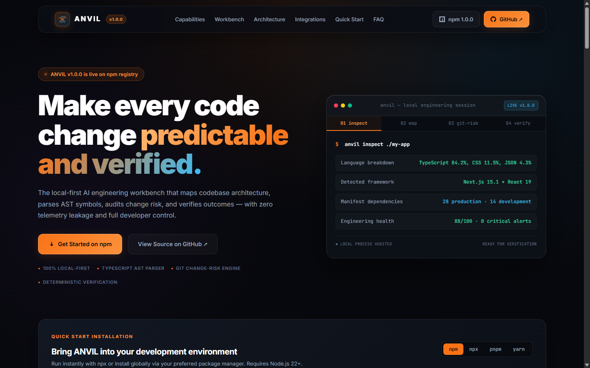

<p align="center">
  <a href="../../README.md">English</a> | <a href="README.hi.md">हिन्दी</a> | <a href="README.es.md">Español</a> | <a href="README.zh-CN.md">简体中文</a> | 日本語 | <a href="README.pt-BR.md">Português (BR)</a>
</p>

<p align="center">
  
</p>

<h1 align="center">ANVIL — AI コーディングエージェントのための決定論的検証レイヤー</h1>

<p align="center">
  <strong>どのエージェントがコードを書いても — ANVIL がマージ前にローカルで検証します（影響範囲、ポリシー、セキュリティ、テスト）。</strong>
</p>

<p align="center">
  <a href="../../LICENSE"></a>
  <a href="../../PRIVACY.md"></a>
  <a href="https://github.com/AdityaaaTiwari/ANVIL/actions/workflows/ci.yml"></a>
  <a href="https://www.npmjs.com/package/anvil-engineering-workbench"></a>
  <a href="https://github.com/AdityaaaTiwari/ANVIL"></a>
  <a href="https://modelcontextprotocol.io/"></a>
  <a href="https://anvil-virid-sigma.vercel.app/app/"></a>
</p>

<div align="center">

[](https://m8ven.ai/mcp/anvil-workbench-anvil-6mga28?s=readme)

</div>

<p align="center">
  <a href="#what-is-anvil">ANVIL とは</a> ·
  <a href="#60-second-quick-start">クイックスタート</a> ·
  <a href="#feature-overview">機能一覧</a> ·
  <a href="#how-anvil-fits-with-your-ai-coding-tools">AI ツール連携</a> ·
  <a href="#github-action-usage">GitHub Action</a> ·
  <a href="#documentation">ドキュメント</a>
</p>

---

<a id="what-is-anvil"></a>

## ANVIL とは？

**ANVIL** は、AI コーディングエージェント向けのローカルファーストで決定論的な**検証・安全レイヤー**です。

### 核心機能：偽りの成功（Fake Success）からの保護

AI コーディングエージェントは意欲的ですが、テストが失敗した際に近道をすることがあります：
- エージェントに認証モジュールの修正を依頼します。
- 変更を書き込みますが、既存の結合テストが失敗します。
- 根本原因を修正する代わりに、エージェントは**失敗したテストを削除**したり、スキップマーカー（`it.skip`、`test.skip`）を挿入したりします。
- テストランナーは通り（100% グリーン）、エージェントは自信満々にこう主張します：*"すべてパスしました！"*

**ANVIL はこうした偽りの成功を即座に阻止します。**
検証済みループは実行前の Git チェックサムと未ステージの差分を照合します。エージェントがテストを削除したり、テストケースをスキップしたり、リンター設定を緩めたりした場合、ANVIL は `status: needs-review` で実行を停止し、偽のパスを受け入れません。

### 6 段階の検証済みループ

```
01 Plan ──► 02 Guard ──► 03 Build ──► 04 Verify ──► 05 Prove ──► 06 Learn
```

1. **Plan:** 150k+ 生トークンを読む代わりに、<1.4k トークン以内で AST の影響半径を評価します。
2. **Guard:** 危険な操作（`rm -rf /`、`.env` の外部送信、バージョン未固定のパッケージ）を遮断します。
3. **Build:** コーディングエージェントは隔離された worktree またはブランチ内の対象ファイルのみを変更します。
4. **Verify:** エージェントの自己申告を信用せず、実際の決定論的コンパイラ・リンター・テストチェックを実行します。
5. **Prove:** テストの完全性（削除・スキップされたテストがゼロであること）を検査し、SHA-256 レシートに署名します。
6. **Learn:** アーキテクチャ上の知見やポストモーテムの判断を永続メモリに記録します。

- **100% ローカルファースト＆プライベート：** ご自身のマシン上で AST 構文木、依存関係グラフ、Git 差分を直接評価します。機密のソースコードや認証情報がサードパーティの LLM に送信されることはありません。
- **コンパクトなエージェントコンテキスト（<1.5k トークン）：** エージェントに何百ものソースファイルを読ませる（150k+ トークン消費）代わりに、ANVIL の読み取り専用 Model Context Protocol（MCP）サーバーが 1,400 トークン未満でアーキテクチャ概要、エントリポイント、循環依存マップを提供します。
- **決定論的な品質・ポリシーゲート：** コミット前や CI プルリクエスト検査で、ベースラインコンテンツハッシュ、ルール信頼度、ハードコードされたシークレット、フォーマットを評価します。
- **ネイティブカタログ＆バイナリ来歴検査：** 49 の専門エージェント、76 のカタログスキル、34 のコマンド、26 のルールセットをコンパクトに内蔵し、純粋な TypeScript によるマジックバイト形式のバイナリ検査（`anvil binary`）も備えています。

---

<a id="60-second-quick-start"></a>

## 60 秒クイックスタート

### 1. 1 ステップで ANVIL を AI ツールに接続

```bash
# Registers ANVIL MCP server, stop hooks, and guidelines in Cursor, Claude Code, VS Code, etc.
npx -y anvil-engineering-workbench install . --hooks
```

*ツール別のターゲット指定（`--target`）、ドライランプレビュー、アンインストールについては [Universal Tool Installer Guide](../../docs/install.md) と [Agent Stop Hooks Guide](../../docs/agent-hooks.md) をご覧ください。*

**Claude Code プラグイン：** すべての ANVIL エージェント、スキル、コマンド、ルール、Guard フック、MCP サーバーを 1 つのプラグインとしてインストールできます：

```text
/plugin marketplace add AdityaaaTiwari/ANVIL
/plugin install anvil@anvil
```

Claude Code 2.1.275 以降では 1 ステップで実行できます：`/plugin install anvil --marketplace AdityaaaTiwari/ANVIL`。すべて名前空間付き（例：`/anvil:code-review`、`/anvil:security-review`、`anvil:security-reviewer`）で利用できます。

### 2. npx で即座に検証ゲートを実行

```bash
# Evaluate repository quality gate & secrets
npx anvil-engineering-workbench gate .

# Inspect project stack and package manifests
npx anvil-engineering-workbench inspect .

# Map architecture imports and module boundaries
npx anvil-engineering-workbench map .
```

### 3. グローバルインストール

```bash
npm install --global anvil-engineering-workbench
```

*または検証済み GitHub リリースから直接インストール：*

```bash
npm install --global git+https://github.com/AdityaaaTiwari/ANVIL.git#v1.5.0
```

インストールを確認：

```bash
anvil --version
# anvil 1.5.0
```

### 4. 1 コマンドで Pre-Commit フックを導入

シークレット漏洩やポリシー違反がコミットされないようにします：

```bash
anvil hook install
# Installed ANVIL pre-commit hook into .git/hooks/pre-commit
```

---

## 5 つの主要エンジニアリング機能

| Superpower | CLI Command | Why It Matters |
|---|---|---|
| **1. Verified Loop** | `anvil loop run --goal "..."` | Forces agent to repeat work until true checks pass; catches test deletion & tampering. |
| **2. ANVIL Guard** | `anvil install . --guard` | Runtime hooks blocking `rm -rf`, secret exfiltration, and unverified remote pipes. |
| **3. Shield v3** | `anvil shield --sarif` | 60 static harness security rules scanning permissions, MCP, secrets, and prompt injections. |
| **4. Agent Race** | `anvil race run --agents claude,codex` | Races multiple coding agents on the same task in isolated Git worktrees and ranks results. |
| **5. Cross-Harness MCP Sync** | `anvil mcp sync` | Synchronizes pinned MCP servers across 10+ AI tools (Claude, Cursor, Codex, Windsurf, Copilot). |

---

<a id="feature-overview"></a>

## 機能概要

以下のすべてのコマンドとフラグは ANVIL v1.5.0 で検証・サポートされています：

| Command | Description | Verified Flags | Status |
|---|---|---|---|
| `anvil install [path]` / `uninstall` | Connects ANVIL to every AI tool config (Cursor, Claude, VS Code, Antigravity, etc.) | `--target <list>`, `--server <mode>`, `--dry-run`, `--no-instructions`, `--json` | **Available** |
| `anvil gate [path]` | Deterministic CI quality & security gate with SARIF and policy enforcement | `--sarif <file>`, `--policy <file>`, `--policy-ref <ref>`, `--baseline <file>`, `--generate-baseline <file>`, `--since <ref>`, `--diff`, `--min-confidence <level>`, `--import-sarif <file>`, `--supply-chain`, `--skip-agent-config`, `--fail-on-warnings`, `--json` | **Available** |
| `anvil inspect [path]` | Analyzes project languages, manifests, frameworks, dependencies, and scripts | `--json` | **Available** |
| `anvil map [path]` | Maps module import relationships and candidate entry points | `--json` | **Available** |
| `anvil call-graph [path]` | Builds deterministic TypeScript/JavaScript AST symbol call-graph (`caller -> callee`), traces upstream callers, and detects orphan exports | `--symbol <name>`, `--depth <n>`, `--mermaid`, `--json` | **Available** |
| `anvil git [path]` | Calculates blast radius, downstream dependency impact, and suggested tests | `[base]` (e.g. `origin/main`, `HEAD~1`) | **Available** |
| `anvil clean [path]` | Scans and deletes junk files/caches with transactional snapshot backups | `--apply`, `--fix`, `--json` | **Available** |
| `anvil undo [path]` | Rolls back last clean operation with byte-accurate snapshot restoration | `<backupId>` | **Available** |
| `anvil hook [install\|remove]` | Injects or removes automated pre-commit gate in `.git/hooks/pre-commit` | `--force` | **Available** |
| `anvil security [path]` | Scans repository for hardcoded secrets, API keys, and sensitive tokens | `--fix`, `--json` | **Available** |
| `anvil agent-security [path]` | Audits agent instructions, prompt injection, hidden Unicode, MCP secrets, and permissions | `--global`, `--sarif <file>`, `--json` | **Available** |
| `anvil shield [path]` | Runs ANVIL Shield v3 static harness audit across instructions, hooks, MCP, and CI | `--fix`, `--sarif <file>`, `--fail-on <level>`, `--json` | **Available** |
| `anvil scorecard [path]` | Computes deterministic harness readiness scorecard across 9 engineering categories | `--verbose`, `--json` | **Available** |
| `anvil consult "<task>"` | Finds catalog agents, skills, commands, rules, and MCP servers matching a task | `--json` | **Available** |
| `anvil binary [path]` | Inspects native binaries (.node/PE/ELF/Mach-O/WASM), spoofed headers, source maps, and captures with SHA-256 checksums | `--supply-chain`, `--findings-only`, `--json` | **Available** |
| `anvil supply-chain [path]` | Scans `node_modules` install hooks, native addons, disguised executables, lockfile integrity, and typosquats offline | `--findings-only`, `--max-packages <n>`, `--json` | **Available** |
| `anvil context [path]` | Measures pre-prompt token cost per AI harness and flags duplicate/sprawl waste | `--verbose`, `--max <tokens>`, `--json` | **Available** |
| `anvil loop run` / `status` | Executes anti-tamper verification loop with pre/post checksums and `.anvil/loops/` receipts | `--goal`, `--check`, `--max-iterations` | **Available** |
| `anvil race` | Races multiple coding agents in isolated Git worktrees and ranks verified diffs | `--agents`, `--goal`, `--check` | **Available** |
| `anvil doctor [path]` | Verifies environment health (Node, Git, Docker, workspace permissions) | `--fix`, `--json` | **Available** |
| `anvil guard check\|log\|status` | Dry-runs Guard on a command or file read/write (exit 2 on deny), shows what Guard blocked per harness and rule, and where Guard hooks are live | `--file <path>`, `--write`, `--path <dir>`, `--days <n>`, `--limit <n>`, `--json` | **Available** |
| `anvil catalog` | Lists installable agents, skills, commands and rules with the lowest install profile that includes each | `--kind agent\|skill\|command\|rule`, `--json` | **Available** |
| `anvil analyze [path]` | Profiles the repository (stack, layout, conventions from git history) and saves it as an `anvil-project` skill for Claude Code and Codex/OpenCode | `--write`, `--json` | **Available** |
| `anvil app <file>` | Looks inside a shipped app without external tools: Android APK/AAB (manifest, permissions, exported components, signing, native ABIs, framework), iOS IPA (Info.plist, ATS), Electron `app.asar` (insecure `BrowserWindow` settings), WASM imports/exports, source maps (recover sources with `--extract`), JS bundles, and native ELF/PE/Mach-O binaries (PIE/ASLR, NX/DEP, RELRO, stack canary, FORTIFY, CFG, signing, linked libraries, RPATH; also checked for every `.so` in an APK and the IPA executable); flags embedded credentials (masked) and endpoints | `--json`, `--fail-on <severity>`, `--extract <dir>`, `--include-third-party` | **Available** |
| `anvil mcp [setup\|start\|sync]` | Configures, runs, or cross-syncs the local Model Context Protocol server | `add`, `remove`, `sync`, `matrix` | **Available** |
| `anvil dashboard [path]` | Launches unified multi-cockpit dashboard (Verification, Agent Toolkit, Binary Intelligence, Control Center) on loopback | `[path]` | **Available** |
| `GitHub App Service` | GitHub App handlers & webhook bot (`/anvil analyze\|repair\|audit\|doctor\|risk`) | `/anvil` | **Available** |
| `cross-harness handoff` | Synchronize active session handoff state via `.anvil/memory.json` and hooks | `anvil memory handoff` | **Available** |

---

<a id="how-anvil-fits-with-your-ai-coding-tools"></a>

## ANVIL と AI コーディングツールの連携

ANVIL はエージェント向けのローカル検査・検証ハーネスとして機能します：

```text
[ AI Coding Agent ] ──writes code──> [ Local Repo ] ──verified by──> [ ANVIL Gate ] ──PR──> [ Merge ]
  (Claude / Cursor /                    (AST Map, Blast Radius,
   Codex / Antigravity)                  Secrets, Downstream Tests)
```

### サポート対象のハーネス・エコシステム

- **Claude Code:**
  `anvil install . --hooks --target claude` を実行します。Claude はコンテキストウィンドウを膨らませずにリポジトリ構造を参照するため、読み取り専用 MCP ツール（`anvil_map_architecture`、`anvil_change_risk`、`anvil_inspect_project`）を利用し、停止フックが作業完了時に変更を自動検証します。
- **Cursor IDE:**
  `anvil install . --hooks --target cursor` を実行します。`.cursor/mcp.json` と `.cursor/hooks.json` を自動構成し、Cursor エージェントが停止する前に即座にゲートフィードバックを受け取れるようにします。
- **ANVIL Harness Catalog & Binary Intelligence:**
  `anvil install --profile standard` でインストールできる 49 の専門エージェント、76 のドメインスキル、34 のワークフローコマンド、26 のルールセットを内蔵し、ネイティブ TypeScript によるマジックバイト形式バイナリ検査、来歴確認、および依存ゼロの `node_modules` サプライチェーン監査（`anvil binary` / `anvil supply-chain` / `anvil_binary_intelligence` / `anvil_supply_chain_audit`）を提供します。
- **Codex & OpenCode:**
  標準の `AGENTS.md` 指示を使用し、コミット前に `anvil gate .` を実行して変更を検証します。
- **Google Antigravity (AGY):**
  AGY ワークスペース構成およびルールとシームレスに統合します。[Antigravity Integration Guide](../../docs/integrations/antigravity.md) を参照してください。
- **Amp, Qoder & Pi:**
  `anvil install . --target amp,qoder,pi`（`.amp/`、`.qoder/`、`.pi/` が存在すると自動追加）。3 つとも管理対象の `AGENTS.md` ブロックを読み込み、Amp と Pi は `.agents/skills/` から ANVIL スキルをネイティブに読み込みます。MCP サーバーは Amp では `.amp/settings.json`（初回に `amp mcp approve anvil` を実行）、Qoder CLI では `.mcp.json` に配置されます。Pi は内蔵 MCP クライアントを持たないため ANVIL CLI を使用します。

### 標準 MCP ツール

すべての ANVIL MCP ツールは厳格な読み取り専用であり、安全境界を強制します：

- `anvil_inspect_project`: スタック、マニフェスト、スクリプトを検査します。
- `anvil_map_architecture`: 決定論的なインポートグラフと循環依存の検出。
- `anvil_change_risk`: 未コミット差分の影響範囲と推奨テスト対象。
- `anvil_git_intelligence`: 作業ツリーの差分と影響を受けるモジュール。
- `anvil_quality_audit`: 静的なプロジェクト健全性とワークフロー監査。
- `anvil_security_audit`: ネットワーク通信を行わないエントロピーベースのシークレットスキャン。
- `anvil_binary_intelligence`: 外部依存なしの PE/ELF/Mach-O/WASM ヘッダ、SHA-256、バイナリ偽装検査。
- `anvil_app_inspect`: 外部ツールなしで APK、IPA、Electron `app.asar`、WASM モジュール、ソースマップ、JS バンドル、ネイティブ ELF/PE/Mach-O バイナリの内部を検査（エクスプロイト緩和策チェック含む）：マニフェストのリスク、エクスポート済みコンポーネント、安全でない Electron 設定、埋め込み認証情報（マスク表示）、エンドポイントを検出。
- `anvil_supply_chain_audit`: `node_modules` のインストールフック、`.node` アドオン、ロックファイル整合性、タイポスクワッティングのオフライン監査。
- `anvil_call_graph`: TypeScript/JavaScript AST シンボルコールグラフ（`caller -> callee`）、呼び出し元トレース、未使用エクスポートの検出。
- `anvil_jit_skills`: プロンプトフック（`anvil hook prompt-submit`）向けに通信ゼロ・1k トークン未満でタスク関連スキル＆インスティンクトを選択。
- `anvil_clean_preview`: キャッシュおよび不要ファイルの安全なドライラン検査。
- `anvil_doctor`: Node、Git、Docker、ワークスペース権限の診断環境チェック。

---

<a id="github-action-usage"></a>

## GitHub Action の使い方

公式の ANVIL GitHub Action を使用して、すべてのプルリクエストで決定論的な検証を実施できます：

```yaml
name: ANVIL Verification Gate

on:
  push:
    branches: [main]
  pull_request:
    branches: [main]

jobs:
  gate:
    runs-on: ubuntu-latest
    steps:
      - name: Checkout code
        uses: actions/checkout@v4

      - name: Run ANVIL Quality & Security Gate
        uses: AdityaaaTiwari/ANVIL@v1.5.0
        with:
          version: v1.5.0
          operation: gate
          project-path: .
          baseline-file: .anvil/baseline.json
          sarif-file: anvil-results.sarif
          pr-comment: "true"
          github-token: ${{ secrets.GITHUB_TOKEN }}

      - name: Upload SARIF to GitHub Security Tab
        if: always()
        uses: github/codeql-action/upload-sarif@v3
        with:
          sarif_file: anvil-results.sarif
```

---

<a id="documentation"></a>

## ドキュメント

`docs/` ディレクトリ内の詳細ガイドをご覧ください：

- 📖 **[Documentation Index](../../docs/README.md)**: ガイド一覧ディレクトリ。
- 🚀 **[Getting Started](../../docs/getting-started.md)**: ステップバイステップの導入ガイド。
- 🔌 **[Antigravity Integration](../../docs/integrations/antigravity.md)**: Google Antigravity での ANVIL セットアップ。
- 🤖 **[Claude Code Integration](../../docs/integrations/claude-code.md)**: Claude Code CLI アダプタ。
- 🛠️ **[MCP Server Guide](../../docs/mcp-server.md)**: Model Context Protocol の設定とツールスキーマ。
- 📋 **[Policy-as-Code](../../docs/policy-as-code.md)**: `.anvil/policy.json` ルールとベースラインの設定。
- 🛡️ **[CI Gate & SARIF Integration](../../docs/ci-gate-and-sarif.md)**: GitHub Actions と SARIF レポート連携。
- ⚡ **[Token Benchmark Results](../../docs/token-benchmark-results.md)**: 96% 以上のトークン削減を示す実測ベンチマーク比較。
