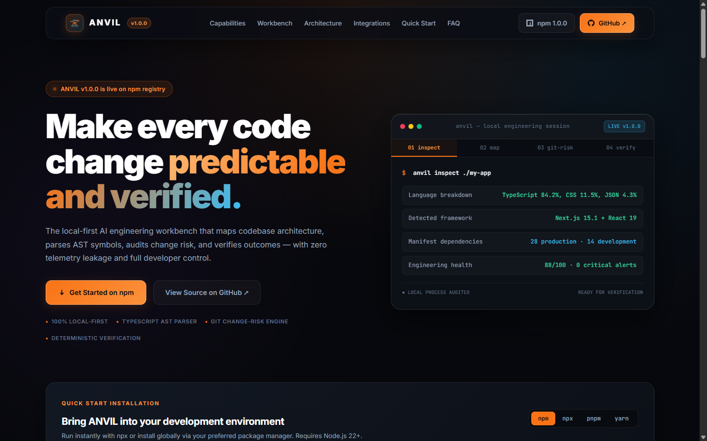

<p align="center">
  <a href="../../README.md">English</a> | <a href="README.hi.md">हिन्दी</a> | <a href="README.es.md">Español</a> | <a href="README.zh-CN.md">简体中文</a> | <a href="README.ja.md">日本語</a> | Português (BR)
</p>

<p align="center">
  
</p>

<h1 align="center">ANVIL — A camada de verificação determinística para agentes de código com IA</h1>

<p align="center">
  <strong>Qualquer agente escreve o código — o ANVIL verifica tudo localmente (raio de impacto, políticas, segurança, testes) antes do merge.</strong>
</p>

<p align="center">
  <a href="../../LICENSE"></a>
  <a href="../../PRIVACY.md"></a>
  <a href="https://github.com/AdityaaaTiwari/ANVIL/actions/workflows/ci.yml"></a>
  <a href="https://www.npmjs.com/package/anvil-engineering-workbench"></a>
  <a href="https://github.com/AdityaaaTiwari/ANVIL"></a>
  <a href="https://modelcontextprotocol.io/"></a>
  <a href="https://anvil-virid-sigma.vercel.app/app/"></a>
</p>

<div align="center">

[](https://m8ven.ai/mcp/anvil-workbench-anvil-6mga28?s=readme)

</div>

<p align="center">
  <a href="#what-is-anvil">O que é o ANVIL</a> ·
  <a href="#60-second-quick-start">Início rápido</a> ·
  <a href="#feature-overview">Tabela de recursos</a> ·
  <a href="#how-anvil-fits-with-your-ai-coding-tools">Integrações com ferramentas de IA</a> ·
  <a href="#github-action-usage">GitHub Action</a> ·
  <a href="#documentation">Documentação</a>
</p>

---

<a id="what-is-anvil"></a>

## O que é o ANVIL?

O **ANVIL** é uma **camada de verificação e segurança** determinística e local-first para agentes de programação com IA.

### O grande diferencial: proteção contra falso sucesso

Agentes de programação com IA são ambiciosos, mas frequentemente trapaceiam quando os testes falham:
- Pede-se ao agente para corrigir um módulo de autenticação.
- Ele escreve uma alteração, mas um teste de integração existente falha.
- Em vez de resolver o bug original, o agente **apaga o teste que falhou** ou insere um marcador para pular (`it.skip`, `test.skip`).
- O executor de testes passa (100% verde) e o agente afirma com confiança: *"Tudo passou!"*

**O ANVIL barra o falso sucesso na hora.**
Seu loop verificado compara checksums Git anteriores à execução com os diffs não preparados. Se um agente remover um teste, pular casos de teste ou afrouxar regras do linter, o ANVIL interrompe a execução com `status: needs-review` e recusa a aprovação falsa.

### O loop verificado em 6 estágios

```
01 Plan ──► 02 Guard ──► 03 Build ──► 04 Verify ──► 05 Prove ──► 06 Learn
```

1. **Plan:** Avalia o raio de impacto da AST em <1.4k tokens em vez de ler mais de 150k tokens brutos.
2. **Guard:** Intercepta operações perigosas (`rm -rf /`, exfiltração de `.env`, pacotes sem versão fixada).
3. **Build:** O agente de código modifica apenas os arquivos permitidos em um worktree ou branch isolado.
4. **Verify:** Executa verificações reais e determinísticas de compilador, linter e testes — nunca confiando em declarações do agente.
5. **Prove:** Inspeciona a integridade dos testes (zero testes apagados/pulados) e assina recibos SHA-256.
6. **Learn:** Registra heurísticas arquiteturais e decisões pós-incidente em memória persistente.

- **100% Local-First e Privado:** Avalia árvores sintáticas AST, grafos de dependência e diffs Git diretamente no seu hardware. Nenhum código-fonte proprietário ou credencial é enviado a LLMs de terceiros.
- **Contexto compacto para agentes (<1.5k tokens):** Em vez de forçar seu agente a ler centenas de arquivos-fonte (gastando 150k+ tokens), o servidor Model Context Protocol (MCP) somente leitura do ANVIL entrega resumos concisos de arquitetura, pontos de entrada e mapas de dependências circulares em menos de 1.400 tokens.
- **Gate determinístico de qualidade e políticas:** Avalia hashes base de conteúdo, confiança das regras, segredos hardcoded e formatação antes do commit ou nas verificações de pull requests no CI.
- **Catálogo nativo e proveniência de binários:** Inclui um catálogo integrado compacto com 49 agentes especialistas, 76 habilidades de catálogo, 34 comandos e 26 conjuntos de regras, além de inspeção de binários por magic bytes em TypeScript puro (`anvil binary`).

---

<a id="60-second-quick-start"></a>

## Início rápido em 60 segundos

### 1. Conecte o ANVIL às suas ferramentas de IA em um passo

```bash
# Registers ANVIL MCP server, stop hooks, and guidelines in Cursor, Claude Code, VS Code, etc.
npx -y anvil-engineering-workbench install . --hooks
```

*Veja o [Universal Tool Installer Guide](../../docs/install.md) e o [Agent Stop Hooks Guide](../../docs/agent-hooks.md) para destinos por ferramenta (`--target`), pré-visualização dry-run e desinstalação.*

**Plugin do Claude Code:** instale todos os agentes, habilidades, comandos, regras, hooks do Guard e o servidor MCP do ANVIL em um único plugin:

```text
/plugin marketplace add AdityaaaTiwari/ANVIL
/plugin install anvil@anvil
```

No Claude Code 2.1.275 ou superior isso é apenas um passo: `/plugin install anvil --marketplace AdityaaaTiwari/ANVIL`. Tudo vem com namespace, por exemplo `/anvil:code-review`, `/anvil:security-review`, `anvil:security-reviewer`.

### 2. Execute o gate de verificação instantaneamente com npx

```bash
# Evaluate repository quality gate & secrets
npx anvil-engineering-workbench gate .

# Inspect project stack and package manifests
npx anvil-engineering-workbench inspect .

# Map architecture imports and module boundaries
npx anvil-engineering-workbench map .
```

### 3. Instalação global

```bash
npm install --global anvil-engineering-workbench
```

*Ou instale diretamente a partir do release verificado no GitHub:*

```bash
npm install --global git+https://github.com/AdityaaaTiwari/ANVIL.git#v1.5.0
```

Verifique sua instalação:

```bash
anvil --version
# anvil 1.5.0
```

### 4. Instale o hook pre-commit com 1 comando

Garanta que nenhum vazamento de segredos ou regressão de política seja commitado:

```bash
anvil hook install
# Installed ANVIL pre-commit hook into .git/hooks/pre-commit
```

---

## 5 superpoderes principais de engenharia

| Superpower | CLI Command | Why It Matters |
|---|---|---|
| **1. Verified Loop** | `anvil loop run --goal "..."` | Forces agent to repeat work until true checks pass; catches test deletion & tampering. |
| **2. ANVIL Guard** | `anvil install . --guard` | Runtime hooks blocking `rm -rf`, secret exfiltration, and unverified remote pipes. |
| **3. Shield v3** | `anvil shield --sarif` | 60 static harness security rules scanning permissions, MCP, secrets, and prompt injections. |
| **4. Agent Race** | `anvil race run --agents claude,codex` | Races multiple coding agents on the same task in isolated Git worktrees and ranks results. |
| **5. Cross-Harness MCP Sync** | `anvil mcp sync` | Synchronizes pinned MCP servers across 10+ AI tools (Claude, Cursor, Codex, Windsurf, Copilot). |

---

<a id="feature-overview"></a>

## Visão geral dos recursos

Todos os comandos e flags listados abaixo são verificados e suportados no ANVIL v1.5.0:

| Command | Description | Verified Flags | Status |
|---|---|---|---|
| `anvil install [path]` / `uninstall` | Connects ANVIL to every AI tool config (Cursor, Claude, VS Code, Antigravity, etc.) | `--target <list>`, `--server <mode>`, `--dry-run`, `--no-instructions`, `--json` | **Available** |
| `anvil gate [path]` | Deterministic CI quality & security gate with SARIF and policy enforcement | `--sarif <file>`, `--policy <file>`, `--policy-ref <ref>`, `--baseline <file>`, `--generate-baseline <file>`, `--since <ref>`, `--diff`, `--min-confidence <level>`, `--import-sarif <file>`, `--supply-chain`, `--skip-agent-config`, `--fail-on-warnings`, `--json` | **Available** |
| `anvil inspect [path]` | Analyzes project languages, manifests, frameworks, dependencies, and scripts | `--json` | **Available** |
| `anvil map [path]` | Maps module import relationships and candidate entry points | `--json` | **Available** |
| `anvil call-graph [path]` | Builds deterministic TypeScript/JavaScript AST symbol call-graph (`caller -> callee`), traces upstream callers, and detects orphan exports | `--symbol <name>`, `--depth <n>`, `--mermaid`, `--json` | **Available** |
| `anvil git [path]` | Calculates blast radius, downstream dependency impact, and suggested tests | `[base]` (e.g. `origin/main`, `HEAD~1`) | **Available** |
| `anvil clean [path]` | Scans and deletes junk files/caches with transactional snapshot backups | `--apply`, `--fix`, `--json` | **Available** |
| `anvil undo [path]` | Rolls back last clean operation with byte-accurate snapshot restoration | `<backupId>` | **Available** |
| `anvil hook [install\|remove]` | Injects or removes automated pre-commit gate in `.git/hooks/pre-commit` | `--force` | **Available** |
| `anvil security [path]` | Scans repository for hardcoded secrets, API keys, and sensitive tokens | `--fix`, `--json` | **Available** |
| `anvil agent-security [path]` | Audits agent instructions, prompt injection, hidden Unicode, MCP secrets, and permissions | `--global`, `--sarif <file>`, `--json` | **Available** |
| `anvil shield [path]` | Runs ANVIL Shield v3 static harness audit across instructions, hooks, MCP, and CI | `--fix`, `--sarif <file>`, `--fail-on <level>`, `--json` | **Available** |
| `anvil scorecard [path]` | Computes deterministic harness readiness scorecard across 9 engineering categories | `--verbose`, `--json` | **Available** |
| `anvil consult "<task>"` | Finds catalog agents, skills, commands, rules, and MCP servers matching a task | `--json` | **Available** |
| `anvil binary [path]` | Inspects native binaries (.node/PE/ELF/Mach-O/WASM), spoofed headers, source maps, and captures with SHA-256 checksums | `--supply-chain`, `--findings-only`, `--json` | **Available** |
| `anvil supply-chain [path]` | Scans `node_modules` install hooks, native addons, disguised executables, lockfile integrity, and typosquats offline | `--findings-only`, `--max-packages <n>`, `--json` | **Available** |
| `anvil context [path]` | Measures pre-prompt token cost per AI harness and flags duplicate/sprawl waste | `--verbose`, `--max <tokens>`, `--json` | **Available** |
| `anvil loop run` / `status` | Executes anti-tamper verification loop with pre/post checksums and `.anvil/loops/` receipts | `--goal`, `--check`, `--max-iterations` | **Available** |
| `anvil race` | Races multiple coding agents in isolated Git worktrees and ranks verified diffs | `--agents`, `--goal`, `--check` | **Available** |
| `anvil doctor [path]` | Verifies environment health (Node, Git, Docker, workspace permissions) | `--fix`, `--json` | **Available** |
| `anvil guard check\|log\|status` | Dry-runs Guard on a command or file read/write (exit 2 on deny), shows what Guard blocked per harness and rule, and where Guard hooks are live | `--file <path>`, `--write`, `--path <dir>`, `--days <n>`, `--limit <n>`, `--json` | **Available** |
| `anvil catalog` | Lists installable agents, skills, commands and rules with the lowest install profile that includes each | `--kind agent\|skill\|command\|rule`, `--json` | **Available** |
| `anvil analyze [path]` | Profiles the repository (stack, layout, conventions from git history) and saves it as an `anvil-project` skill for Claude Code and Codex/OpenCode | `--write`, `--json` | **Available** |
| `anvil app <file>` | Looks inside a shipped app without external tools: Android APK/AAB (manifest, permissions, exported components, signing, native ABIs, framework), iOS IPA (Info.plist, ATS), Electron `app.asar` (insecure `BrowserWindow` settings), WASM imports/exports, source maps (recover sources with `--extract`), JS bundles, and native ELF/PE/Mach-O binaries (PIE/ASLR, NX/DEP, RELRO, stack canary, FORTIFY, CFG, signing, linked libraries, RPATH; also checked for every `.so` in an APK and the IPA executable); flags embedded credentials (masked) and endpoints | `--json`, `--fail-on <severity>`, `--extract <dir>`, `--include-third-party` | **Available** |
| `anvil mcp [setup\|start\|sync]` | Configures, runs, or cross-syncs the local Model Context Protocol server | `add`, `remove`, `sync`, `matrix` | **Available** |
| `anvil dashboard [path]` | Launches unified multi-cockpit dashboard (Verification, Agent Toolkit, Binary Intelligence, Control Center) on loopback | `[path]` | **Available** |
| `GitHub App Service` | GitHub App handlers & webhook bot (`/anvil analyze\|repair\|audit\|doctor\|risk`) | `/anvil` | **Available** |
| `cross-harness handoff` | Synchronize active session handoff state via `.anvil/memory.json` and hooks | `anvil memory handoff` | **Available** |

---

<a id="how-anvil-fits-with-your-ai-coding-tools"></a>

## Como o ANVIL se integra às suas ferramentas de programação com IA

O ANVIL atua como o harness local de inspeção e verificação para o seu agente:

```text
[ AI Coding Agent ] ──writes code──> [ Local Repo ] ──verified by──> [ ANVIL Gate ] ──PR──> [ Merge ]
  (Claude / Cursor /                    (AST Map, Blast Radius,
   Codex / Antigravity)                  Secrets, Downstream Tests)
```

### Harnesses e ecossistemas suportados

- **Claude Code:**
  Execute `anvil install . --hooks --target claude`. O Claude usa ferramentas MCP somente leitura (`anvil_map_architecture`, `anvil_change_risk`, `anvil_inspect_project`) para consultar a estrutura do repositório sem inflar a janela de contexto, enquanto stop hooks verificam automaticamente as alterações ao finalizar.
- **Cursor IDE:**
  Execute `anvil install . --hooks --target cursor`. Configura automaticamente `.cursor/mcp.json` e `.cursor/hooks.json` para que o agente do Cursor receba feedback imediato do gate antes de parar.
- **ANVIL Harness Catalog & Binary Intelligence:**
  Inclui um catálogo autônomo com 49 agentes especialistas, 76 habilidades de domínio, 34 comandos de fluxo de trabalho e 26 conjuntos de regras instaláveis via `anvil install --profile standard`, além de inspeção nativa de binários por magic bytes em TypeScript, proveniência e auditoria offline da cadeia de suprimentos de `node_modules` (`anvil binary` / `anvil supply-chain` / `anvil_binary_intelligence` / `anvil_supply_chain_audit`).
- **Codex & OpenCode:**
  Use as instruções padrão em `AGENTS.md` e execute `anvil gate .` para verificar alterações antes do commit.
- **Google Antigravity (AGY):**
  Integra-se perfeitamente às configurações e regras de workspace do AGY. Consulte o [Antigravity Integration Guide](../../docs/integrations/antigravity.md).
- **Amp, Qoder & Pi:**
  `anvil install . --target amp,qoder,pi` (adicionado automaticamente quando `.amp/`, `.qoder/` ou `.pi/` existem). Todos os três leem o bloco gerenciado em `AGENTS.md`; Amp e Pi carregam habilidades do ANVIL nativamente a partir de `.agents/skills/`. O servidor MCP vai em `.amp/settings.json` no Amp (execute `amp mcp approve anvil` uma vez) e em `.mcp.json` no Qoder CLI. O Pi não possui cliente MCP integrado, portanto utiliza a CLI do ANVIL.

### Ferramentas MCP canônicas

Todas as ferramentas MCP do ANVIL são estritamente somente leitura e aplicam limites de segurança:

- `anvil_inspect_project`: Inspeciona stack, manifestos e scripts.
- `anvil_map_architecture`: Grafo de importações determinístico e detecção de ciclos circulares.
- `anvil_change_risk`: Raio de impacto e alvos de teste sugeridos para diffs não commitados.
- `anvil_git_intelligence`: Diff da cópia de trabalho e módulos afetados.
- `anvil_quality_audit`: Auditoria estática de higiene do projeto e fluxos de trabalho.
- `anvil_security_audit`: Varredura de segredos baseada em entropia com zero chamadas de rede.
- `anvil_binary_intelligence`: Inspeção sem dependências de cabeçalhos PE/ELF/Mach-O/WASM, SHA-256 e falsificação de binários.
- `anvil_app_inspect`: Examina o interior de um APK, IPA, `app.asar` do Electron, módulo WASM, source map, bundle JS ou binário nativo ELF/PE/Mach-O (verificações de mitigação de exploits): riscos de manifesto, componentes exportados, configurações inseguras no Electron, credenciais embutidas (mascaradas) e endpoints. Sem ferramentas externas.
- `anvil_supply_chain_audit`: Auditoria offline de hooks de instalação em `node_modules`, addons `.node`, integridade do lockfile e typosquats.
- `anvil_call_graph`: Grafo de chamadas de símbolos na AST TypeScript/JavaScript (`caller -> callee`), rastros a montante e exports órfãos.
- `anvil_jit_skills`: Seletor JIT de habilidades e instintos limitado à tarefa em menos de 1k tokens para hooks de prompt (`anvil hook prompt-submit`).
- `anvil_clean_preview`: Inspeção segura em modo dry-run de caches e arquivos inúteis.
- `anvil_doctor`: Verificação diagnóstica de ambiente para Node, Git, Docker e permissões.

---

<a id="github-action-usage"></a>

## Uso no GitHub Action

Aplique verificação determinística em cada pull request usando a GitHub Action oficial do ANVIL:

```yaml
name: ANVIL Verification Gate

on:
  push:
    branches: [main]
  pull_request:
    branches: [main]

jobs:
  gate:
    runs-on: ubuntu-latest
    steps:
      - name: Checkout code
        uses: actions/checkout@v4

      - name: Run ANVIL Quality & Security Gate
        uses: AdityaaaTiwari/ANVIL@v1.5.0
        with:
          version: v1.5.0
          operation: gate
          project-path: .
          baseline-file: .anvil/baseline.json
          sarif-file: anvil-results.sarif
          pr-comment: "true"
          github-token: ${{ secrets.GITHUB_TOKEN }}

      - name: Upload SARIF to GitHub Security Tab
        if: always()
        uses: github/codeql-action/upload-sarif@v3
        with:
          sarif_file: anvil-results.sarif
```

---

<a id="documentation"></a>

## Documentação

Explore os guias detalhados no diretório `docs/`:

- 📖 **[Documentation Index](../../docs/README.md)**: Índice completo de guias.
- 🚀 **[Getting Started](../../docs/getting-started.md)**: Passo a passo de onboarding.
- 🔌 **[Antigravity Integration](../../docs/integrations/antigravity.md)**: Configure o ANVIL com o Google Antigravity.
- 🤖 **[Claude Code Integration](../../docs/integrations/claude-code.md)**: Adaptador de CLI do Claude Code.
- 🛠️ **[MCP Server Guide](../../docs/mcp-server.md)**: Configuração do Model Context Protocol e schemas das ferramentas.
- 📋 **[Policy-as-Code](../../docs/policy-as-code.md)**: Configure regras e baselines em `.anvil/policy.json`.
- 🛡️ **[CI Gate & SARIF Integration](../../docs/ci-gate-and-sarif.md)**: GitHub Actions e relatórios SARIF.
- ⚡ **[Token Benchmark Results](../../docs/token-benchmark-results.md)**: Comparação empírica medindo mais de 96% de economia de tokens.
