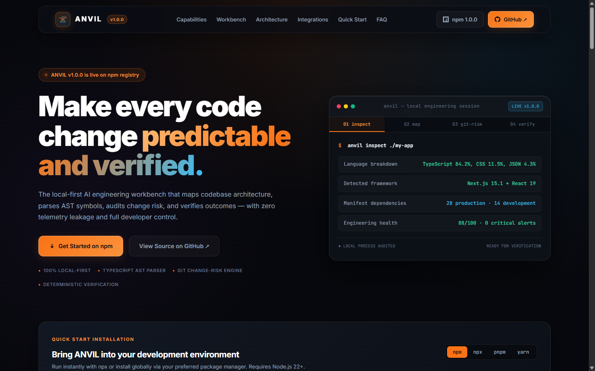

<p align="center">
  <a href="../../README.md">English</a> | <a href="README.hi.md">हिन्दी</a> | <a href="README.es.md">Español</a> | 简体中文 | <a href="README.ja.md">日本語</a> | <a href="README.pt-BR.md">Português (BR)</a>
</p>

<p align="center">
  
</p>

<h1 align="center">ANVIL — 面向 AI 编程代理的确定性验证层</h1>

<p align="center">
  <strong>任何代理编写代码 — ANVIL 在合并前于本地完成验证（影响半径、策略、安全、测试）。</strong>
</p>

<p align="center">
  <a href="../../LICENSE"></a>
  <a href="../../PRIVACY.md"></a>
  <a href="https://github.com/AdityaaaTiwari/ANVIL/actions/workflows/ci.yml"></a>
  <a href="https://www.npmjs.com/package/anvil-engineering-workbench"></a>
  <a href="https://github.com/AdityaaaTiwari/ANVIL"></a>
  <a href="https://modelcontextprotocol.io/"></a>
  <a href="https://anvil-virid-sigma.vercel.app/app/"></a>
</p>

<div align="center">

[](https://m8ven.ai/mcp/anvil-workbench-anvil-6mga28?s=readme)

</div>

<p align="center">
  <a href="#what-is-anvil">什么是 ANVIL</a> ·
  <a href="#60-second-quick-start">快速开始</a> ·
  <a href="#feature-overview">功能概览表</a> ·
  <a href="#how-anvil-fits-with-your-ai-coding-tools">AI 工具集成</a> ·
  <a href="#github-action-usage">GitHub Action</a> ·
  <a href="#documentation">文档</a>
</p>

---

<a id="what-is-anvil"></a>

## 什么是 ANVIL？

**ANVIL** 是面向 AI 编程代理的本地优先、确定性**验证与安全层**。

### 核心突破：防范虚假成功（Fake Success）

AI 编程代理很有野心，但在测试失败时经常投机取巧：
- 要求代理修复某个身份验证模块。
- 它写好了修改，但一个现有的集成测试失败了。
- 代理不去解决根本缺陷，而是**删掉失败的测试**或插入跳过标记（`it.skip`、`test.skip`）。
- 测试运行器全部通过（100% 绿灯），代理便自信地声称：*"所有测试都通过了！"*

**ANVIL 从根源上阻断这种虚假成功。**
其已验证循环会将未暂存的差异与执行前的 Git 校验和进行比对。如果代理删除了测试、跳过了测试用例或放宽了 linter 配置，ANVIL 会以 `status: needs-review` 终止执行，并拒绝接受虚假通过。

### 6 阶段已验证循环

```
01 Plan ──► 02 Guard ──► 03 Build ──► 04 Verify ──► 05 Prove ──► 06 Learn
```

1. **Plan:** 在 <1.4k token 内评估 AST 影响半径，而无需读取 150k+ 原始 token。
2. **Guard:** 拦截危险操作（`rm -rf /`、`.env` 外泄、未锁定版本的包）。
3. **Build:** 编程代理仅在隔离的 worktree 或分支中修改作用域内的文件。
4. **Verify:** 运行真实的确定性编译器、linter 和测试检查——绝不轻信代理的口头声明。
5. **Prove:** 检查测试完整性（零删除/跳过测试）并签署 SHA-256 凭证。
6. **Learn:** 将架构启发式经验与事后复盘决策记录到持久化记忆中。

- **100% 本地优先与隐私安全：** 直接在你的硬件上评估 AST 语法树、依赖图和 Git 差异。绝不会将任何专有源代码或凭据发送给第三方 LLM。
- **紧凑代理上下文（<1.5k Token）：** 无需让代理读取数百个源文件（消耗 150k+ token），ANVIL 的只读 Model Context Protocol（MCP）服务器可在 1,400 token 内提供简洁的架构摘要、入口点和循环依赖图。
- **确定性质量与策略门禁：** 在提交前或 CI Pull Request 检查中评估基线内容哈希、规则置信度、硬编码密钥与代码格式。
- **原生目录与二进制溯源：** 内置精简目录（49 个专家代理、76 项目录技能、34 个命令、26 组规则），并提供纯 TypeScript 魔数（magic-byte）二进制检查（`anvil binary`）。

---

<a id="60-second-quick-start"></a>

## 60 秒快速开始

### 1. 一步将 ANVIL 连接到你的 AI 工具

```bash
# Registers ANVIL MCP server, stop hooks, and guidelines in Cursor, Claude Code, VS Code, etc.
npx -y anvil-engineering-workbench install . --hooks
```

*关于指定工具目标（`--target`）、演练预览（dry-run）和卸载方式，请参阅 [Universal Tool Installer Guide](../../docs/install.md) 和 [Agent Stop Hooks Guide](../../docs/agent-hooks.md)。*

**Claude Code 插件：** 将全部 ANVIL 代理、技能、命令、规则、Guard 钩子和 MCP 服务器作为单个插件一键安装：

```text
/plugin marketplace add AdityaaaTiwari/ANVIL
/plugin install anvil@anvil
```

在 Claude Code 2.1.275 及以上版本中只需一步：`/plugin install anvil --marketplace AdityaaaTiwari/ANVIL`。所有能力均带有命名空间，例如 `/anvil:code-review`、`/anvil:security-review`、`anvil:security-reviewer`。

### 2. 使用 npx 立即运行验证门禁

```bash
# Evaluate repository quality gate & secrets
npx anvil-engineering-workbench gate .

# Inspect project stack and package manifests
npx anvil-engineering-workbench inspect .

# Map architecture imports and module boundaries
npx anvil-engineering-workbench map .
```

### 3. 全局安装

```bash
npm install --global anvil-engineering-workbench
```

*或直接从已验证的 GitHub 发布版本安装：*

```bash
npm install --global git+https://github.com/AdityaaaTiwari/ANVIL.git#v1.5.0
```

验证安装：

```bash
anvil --version
# anvil 1.5.0
```

### 4. 一行命令安装 Pre-Commit 钩子

确保密钥泄漏或策略回退永远不会被提交：

```bash
anvil hook install
# Installed ANVIL pre-commit hook into .git/hooks/pre-commit
```

---

## 5 项核心工程超能力

| Superpower | CLI Command | Why It Matters |
|---|---|---|
| **1. Verified Loop** | `anvil loop run --goal "..."` | Forces agent to repeat work until true checks pass; catches test deletion & tampering. |
| **2. ANVIL Guard** | `anvil install . --guard` | Runtime hooks blocking `rm -rf`, secret exfiltration, and unverified remote pipes. |
| **3. Shield v3** | `anvil shield --sarif` | 60 static harness security rules scanning permissions, MCP, secrets, and prompt injections. |
| **4. Agent Race** | `anvil race run --agents claude,codex` | Races multiple coding agents on the same task in isolated Git worktrees and ranks results. |
| **5. Cross-Harness MCP Sync** | `anvil mcp sync` | Synchronizes pinned MCP servers across 10+ AI tools (Claude, Cursor, Codex, Windsurf, Copilot). |

---

<a id="feature-overview"></a>

## 功能概览

下方列出的每条命令与参数均已在 ANVIL v1.5.0 中验证并支持：

| Command | Description | Verified Flags | Status |
|---|---|---|---|
| `anvil install [path]` / `uninstall` | Connects ANVIL to every AI tool config (Cursor, Claude, VS Code, Antigravity, etc.) | `--target <list>`, `--server <mode>`, `--dry-run`, `--no-instructions`, `--json` | **Available** |
| `anvil gate [path]` | Deterministic CI quality & security gate with SARIF and policy enforcement | `--sarif <file>`, `--policy <file>`, `--policy-ref <ref>`, `--baseline <file>`, `--generate-baseline <file>`, `--since <ref>`, `--diff`, `--min-confidence <level>`, `--import-sarif <file>`, `--supply-chain`, `--skip-agent-config`, `--fail-on-warnings`, `--json` | **Available** |
| `anvil inspect [path]` | Analyzes project languages, manifests, frameworks, dependencies, and scripts | `--json` | **Available** |
| `anvil map [path]` | Maps module import relationships and candidate entry points | `--json` | **Available** |
| `anvil call-graph [path]` | Builds deterministic TypeScript/JavaScript AST symbol call-graph (`caller -> callee`), traces upstream callers, and detects orphan exports | `--symbol <name>`, `--depth <n>`, `--mermaid`, `--json` | **Available** |
| `anvil git [path]` | Calculates blast radius, downstream dependency impact, and suggested tests | `[base]` (e.g. `origin/main`, `HEAD~1`) | **Available** |
| `anvil clean [path]` | Scans and deletes junk files/caches with transactional snapshot backups | `--apply`, `--fix`, `--json` | **Available** |
| `anvil undo [path]` | Rolls back last clean operation with byte-accurate snapshot restoration | `<backupId>` | **Available** |
| `anvil hook [install\|remove]` | Injects or removes automated pre-commit gate in `.git/hooks/pre-commit` | `--force` | **Available** |
| `anvil security [path]` | Scans repository for hardcoded secrets, API keys, and sensitive tokens | `--fix`, `--json` | **Available** |
| `anvil agent-security [path]` | Audits agent instructions, prompt injection, hidden Unicode, MCP secrets, and permissions | `--global`, `--sarif <file>`, `--json` | **Available** |
| `anvil shield [path]` | Runs ANVIL Shield v3 static harness audit across instructions, hooks, MCP, and CI | `--fix`, `--sarif <file>`, `--fail-on <level>`, `--json` | **Available** |
| `anvil scorecard [path]` | Computes deterministic harness readiness scorecard across 9 engineering categories | `--verbose`, `--json` | **Available** |
| `anvil consult "<task>"` | Finds catalog agents, skills, commands, rules, and MCP servers matching a task | `--json` | **Available** |
| `anvil binary [path]` | Inspects native binaries (.node/PE/ELF/Mach-O/WASM), spoofed headers, source maps, and captures with SHA-256 checksums | `--supply-chain`, `--findings-only`, `--json` | **Available** |
| `anvil supply-chain [path]` | Scans `node_modules` install hooks, native addons, disguised executables, lockfile integrity, and typosquats offline | `--findings-only`, `--max-packages <n>`, `--json` | **Available** |
| `anvil context [path]` | Measures pre-prompt token cost per AI harness and flags duplicate/sprawl waste | `--verbose`, `--max <tokens>`, `--json` | **Available** |
| `anvil loop run` / `status` | Executes anti-tamper verification loop with pre/post checksums and `.anvil/loops/` receipts | `--goal`, `--check`, `--max-iterations` | **Available** |
| `anvil race` | Races multiple coding agents in isolated Git worktrees and ranks verified diffs | `--agents`, `--goal`, `--check` | **Available** |
| `anvil doctor [path]` | Verifies environment health (Node, Git, Docker, workspace permissions) | `--fix`, `--json` | **Available** |
| `anvil guard check\|log\|status` | Dry-runs Guard on a command or file read/write (exit 2 on deny), shows what Guard blocked per harness and rule, and where Guard hooks are live | `--file <path>`, `--write`, `--path <dir>`, `--days <n>`, `--limit <n>`, `--json` | **Available** |
| `anvil catalog` | Lists installable agents, skills, commands and rules with the lowest install profile that includes each | `--kind agent\|skill\|command\|rule`, `--json` | **Available** |
| `anvil analyze [path]` | Profiles the repository (stack, layout, conventions from git history) and saves it as an `anvil-project` skill for Claude Code and Codex/OpenCode | `--write`, `--json` | **Available** |
| `anvil app <file>` | Looks inside a shipped app without external tools: Android APK/AAB (manifest, permissions, exported components, signing, native ABIs, framework), iOS IPA (Info.plist, ATS), Electron `app.asar` (insecure `BrowserWindow` settings), WASM imports/exports, source maps (recover sources with `--extract`), JS bundles, and native ELF/PE/Mach-O binaries (PIE/ASLR, NX/DEP, RELRO, stack canary, FORTIFY, CFG, signing, linked libraries, RPATH; also checked for every `.so` in an APK and the IPA executable); flags embedded credentials (masked) and endpoints | `--json`, `--fail-on <severity>`, `--extract <dir>`, `--include-third-party` | **Available** |
| `anvil mcp [setup\|start\|sync]` | Configures, runs, or cross-syncs the local Model Context Protocol server | `add`, `remove`, `sync`, `matrix` | **Available** |
| `anvil dashboard [path]` | Launches unified multi-cockpit dashboard (Verification, Agent Toolkit, Binary Intelligence, Control Center) on loopback | `[path]` | **Available** |
| `GitHub App Service` | GitHub App handlers & webhook bot (`/anvil analyze\|repair\|audit\|doctor\|risk`) | `/anvil` | **Available** |
| `cross-harness handoff` | Synchronize active session handoff state via `.anvil/memory.json` and hooks | `anvil memory handoff` | **Available** |

---

<a id="how-anvil-fits-with-your-ai-coding-tools"></a>

## ANVIL 如何融入你的 AI 编程工具链

ANVIL 作为代理的本地检查与验证框架运行：

```text
[ AI Coding Agent ] ──writes code──> [ Local Repo ] ──verified by──> [ ANVIL Gate ] ──PR──> [ Merge ]
  (Claude / Cursor /                    (AST Map, Blast Radius,
   Codex / Antigravity)                  Secrets, Downstream Tests)
```

### 支持的工具链与生态

- **Claude Code：**
  运行 `anvil install . --hooks --target claude`。Claude 通过只读 MCP 工具（`anvil_map_architecture`、`anvil_change_risk`、`anvil_inspect_project`）查询仓库结构，避免上下文窗口膨胀；同时停止钩子（stop hooks）会在完成任务时自动检查变更。
- **Cursor IDE：**
  运行 `anvil install . --hooks --target cursor`。自动配置 `.cursor/mcp.json` 和 `.cursor/hooks.json`，使 Cursor 代理在停止前即时收到门禁反馈。
- **ANVIL Harness Catalog & Binary Intelligence：**
  随附可通过 `anvil install --profile standard` 安装的独立目录（49 个专家代理、76 项领域技能、34 个工作流命令与 26 组规则），以及纯 TypeScript 魔数二进制检测、来源校验和零依赖 `node_modules` 供应链离线审计（`anvil binary` / `anvil supply-chain` / `anvil_binary_intelligence` / `anvil_supply_chain_audit`）。
- **Codex & OpenCode：**
  遵循标准 `AGENTS.md` 指令，并在提交前运行 `anvil gate .` 验证改动。
- **Google Antigravity (AGY)：**
  与 AGY 工作区配置及规则无缝集成。请参阅 [Antigravity Integration Guide](../../docs/integrations/antigravity.md)。
- **Amp, Qoder & Pi：**
  `anvil install . --target amp,qoder,pi`（当 `.amp/`、`.qoder/` 或 `.pi/` 存在时自动识别添加）。三者均读取受管的 `AGENTS.md` 区块；Amp 和 Pi 直接从 `.agents/skills/` 原生加载 ANVIL 技能。MCP 服务器写入 Amp 的 `.amp/settings.json`（首次运行一次 `amp mcp approve anvil`）及 Qoder CLI 的 `.mcp.json`。Pi 没有内置 MCP 客户端，因此直接使用 ANVIL CLI。

### 标准 MCP 工具

所有 ANVIL MCP 工具均严格为只读，并强制执行安全边界：

- `anvil_inspect_project`：检查技术栈、清单文件与脚本。
- `anvil_map_architecture`：确定性导入依赖图与循环依赖检测。
- `anvil_change_risk`：未提交差异的影响半径与推荐测试目标。
- `anvil_git_intelligence`：工作区变更差异及受影响模块。
- `anvil_quality_audit`：静态项目规范与工作流审计。
- `anvil_security_audit`：零网络调用的基于熵值的密钥扫描。
- `anvil_binary_intelligence`：零依赖 PE/ELF/Mach-O/WASM 文件头、SHA-256 与二进制伪装检查。
- `anvil_app_inspect`：无需外部工具直接剖析单个 APK、IPA、Electron `app.asar`、WASM 模块、Source Map、JS Bundle 或原生 ELF/PE/Mach-O 二进制文件（漏洞缓解措施检测）：检查清单风险、导出组件、不安全 Electron 配置、内嵌凭据（已脱敏）及网络端点。
- `anvil_supply_chain_audit`：离线审计 `node_modules` 安装脚本钩子、`.node` 原生插件、锁文件完整性与名称仿冒（typosquat）。
- `anvil_call_graph`：TypeScript/JavaScript AST 符号调用图（`caller -> callee`）、上游调用溯源与孤立导出检测。
- `anvil_jit_skills`：面向提示词钩子（`anvil hook prompt-submit`）的零网络调用、按任务筛选且控制在 1k token 以内的 JIT 技能与直觉选择器。
- `anvil_clean_preview`：缓存与垃圾文件的安全演练（dry-run）检查。
- `anvil_doctor`：检测 Node、Git、Docker 与工作区权限的环境诊断检查。

---

<a id="github-action-usage"></a>

## GitHub Action 用法

使用官方 ANVIL GitHub Action 在每次 Pull Request 上强制执行确定性验证：

```yaml
name: ANVIL Verification Gate

on:
  push:
    branches: [main]
  pull_request:
    branches: [main]

jobs:
  gate:
    runs-on: ubuntu-latest
    steps:
      - name: Checkout code
        uses: actions/checkout@v4

      - name: Run ANVIL Quality & Security Gate
        uses: AdityaaaTiwari/ANVIL@v1.5.0
        with:
          version: v1.5.0
          operation: gate
          project-path: .
          baseline-file: .anvil/baseline.json
          sarif-file: anvil-results.sarif
          pr-comment: "true"
          github-token: ${{ secrets.GITHUB_TOKEN }}

      - name: Upload SARIF to GitHub Security Tab
        if: always()
        uses: github/codeql-action/upload-sarif@v3
        with:
          sarif_file: anvil-results.sarif
```

---

<a id="documentation"></a>

## 文档

在 `docs/` 目录中查看更多详细指南：

- 📖 **[Documentation Index](../../docs/README.md)**：完整指南目录。
- 🚀 **[Getting Started](../../docs/getting-started.md)**：分步上手指南。
- 🔌 **[Antigravity Integration](../../docs/integrations/antigravity.md)**：在 Google Antigravity 中配置 ANVIL。
- 🤖 **[Claude Code Integration](../../docs/integrations/claude-code.md)**：Claude Code CLI 适配器。
- 🛠️ **[MCP Server Guide](../../docs/mcp-server.md)**：Model Context Protocol 配置与工具 Schema。
- 📋 **[Policy-as-Code](../../docs/policy-as-code.md)**：配置 `.anvil/policy.json` 规则与基线。
- 🛡️ **[CI Gate & SARIF Integration](../../docs/ci-gate-and-sarif.md)**：GitHub Actions 与 SARIF 报告集成。
- ⚡ **[Token Benchmark Results](../../docs/token-benchmark-results.md)**：实测节省 96%+ token 的对比基准。
